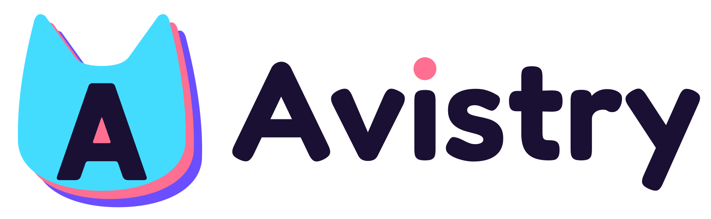
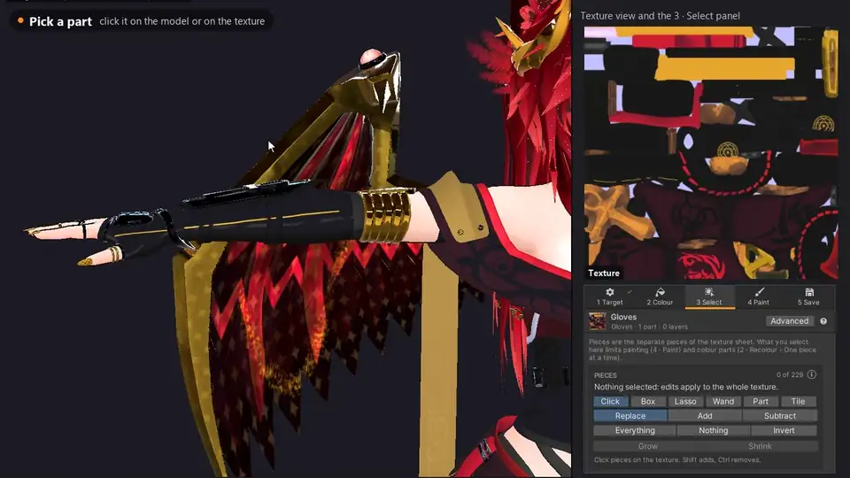
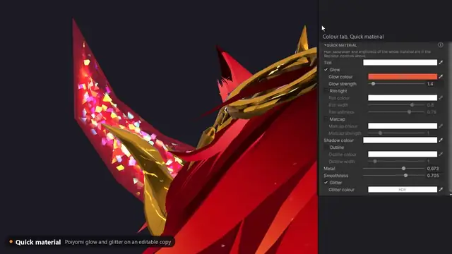
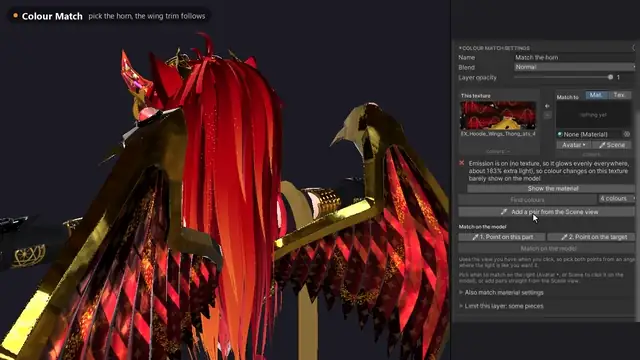
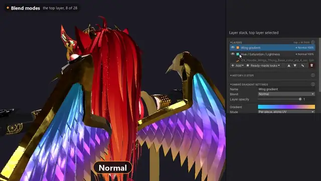
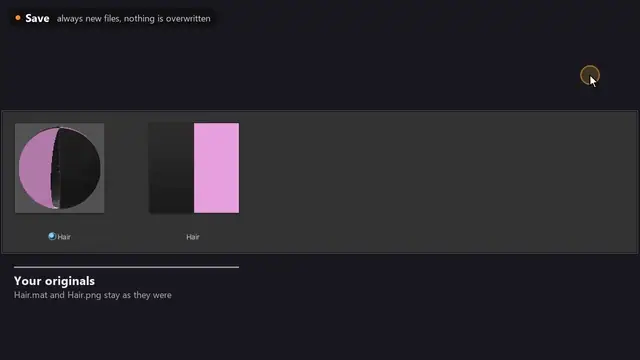

<h1 align="center">
  <picture>
    <source media="(prefers-color-scheme: dark)" srcset="../../Website~/media/lockup.svg">
    
  </picture>
</h1>

  <a href="../../README.md">English</a> |
  日本語 |
  <a href="README.ko.md">한국어</a> |
  <a href="README.zh-CN.md">简体中文</a>

  VRChatアバターのテクスチャを、Unityの中で色替え・ペイント・修正できます。 
  パーツを選んで変更すると、アバターにそのまま反映されます。あとは新しいPNGとして保存するだけ。元のファイルは変わりません。

  
  
  

  
  
  
  

  

  <b>1</b> パーツを選ぶ &nbsp;·&nbsp; <b>2</b> 色を選ぶ &nbsp;·&nbsp; <b>3</b> 細部をペイント &nbsp;·&nbsp; <b>4</b> 新しいコピーとして保存
   Unityで録画しました。

## なぜAvistryなのか

アバターを手に入れたら、Avistryで自分のものにしましょう。Avistryは、丁寧に作ったVRChatアバター用ツールキットです。どのツールも、クリエイターの実際の困りごとをわかりやすい言葉で解決し、公開する前に完成した状態になっていることを大切にしています。

- **設計から安全。** 元のファイルを上書きせず、Unityエディタの中だけで動き、データは一切送りません。これは設定ではなく、コードに組み込んだルールです。
- **量より質。** ほぼ動くツールが10個あるより、きちんと動くツールが1つあるほうがいい。散らかる機能は、お断りしています。
- **コミュニティと育てる。** アイデアはDiscordで話し合い、コントリビューションはAIエージェントを使って作られることも多く、メンテナーがすべての変更をUnityで確認してテストします。ここでAIは道具であり、作者ではありません。

## できること

<table>
  <tr>
    <td width="50%" valign="top">
      
       <b>マテリアル全体の色替え。</b> PoiyomiとlilToonでは、影・リム・マットキャップ・アウトライン・発光の色も、
      シェーダー自身の設定を通して一緒に変わります。
    </td>
    <td width="50%" valign="top">
      
       <b>ペイント。</b> 筆圧対応の11種類のブラシに加えて、塗りつぶし、グラデーション、ぼかし、指先ツール。
      テクスチャ上にも3Dモデルに直接も描けて、ミラーもできます。
    </td>
  </tr>
  <tr>
    <td width="50%" valign="top">
      
       <b>色合わせ。</b> 髪に衣装の色を、あるいはその逆を、元の陰影を残したまま移せます。
    </td>
    <td width="50%" valign="top">
      
       <b>レイヤーで作業。</b> 28種類の合成モード、マスク、クリッピング、画像レイヤー、色調補正レイヤー。
      どの操作も、非表示、並べ替え、元に戻すができます。
    </td>
  </tr>
</table>

ほかにもあります。

- **1つのピースだけ編集。** 袖、リボン、ベルトをクリックすると、そのピースだけが変わります。Sceneビューでも同じです。
- **補助マップのベイク。** アンビエントオクルージョン、テクスチャから作る法線マップ、アニメ調の顔向けのフェイスシャドウマップ。
- **マテリアルのチェック。** ピンク表示のシェーダー、空のスロット、足りないテクスチャ、おかしなインポート設定を、わかりやすい言葉で説明します。
  安全に直せるものは、ワンクリックで修正できます。
- **使いながら学ぶ。** SimpleモードとAdvancedモード、情報アイコン、41語の用語集、Unity初心者向けのスキルツリー。

全機能は[機能ページ](https://avistry.github.io/avistry/features.html)にまとめています。

  
   保存では必ず新しいファイルを作ります。元のテクスチャとマテリアルはそのままです。

## インストール

VRChatが使っているUnity 2022.3が必要です。方法を1つ選んで、アップデートも同じ方法で行ってください。

**VRChat Creator Companion(おすすめ)。** [プロジェクトのページ](https://avistry.github.io/avistry/)を開いて
**Add to VCC** を押します。あるいはVCCの *Settings › Packages › Add Repository* に
`https://avistry.github.io/avistry/index.json` を貼り付けます。そのあと *Manage Project* でAvistryの横の **+** を押します。
アップデートもそこに表示されます。

**.unitypackage。** [最新リリース](https://github.com/avistry/avistry/releases/latest)からダウンロードして、
Projectウィンドウにドラッグします。ツールは Assets の下ではなく `Packages/com.avistry.toolkit` に入ります。

**Git URL。** *Window › Package Manager* で **+** を押し、*Add package from git URL…* を選んで
`https://github.com/avistry/avistry.git` を貼り付けます。

ほかのパッケージは必要ありません。PoiyomiかlilToonが入っていれば、Colourタブにそれ用の項目が追加されます。
最初期のテストビルドを使ったことがある人は、先に `Assets/AvatarTextureStudio` を削除してください(VCCなら自動で取り除かれます)。

## クイックスタート

1. **Tools › Avistry › Textures** を選び、アバターのパーツを選んで、テクスチャを選択します。
2. 手早く色を変えるなら **Colour** を、ピースを選んで塗るなら **Select** のあとに **Paint** を使います。アバターには操作に合わせてすぐ反映されます。
3. **Save** タブで **Save as new PNG** を押します。

保存するまでは何も書き込まれません。Ctrl+Zですべての編集を元に戻せて、未保存のままウィンドウを閉じようとすると確認が出ます。

## 安全性と信頼性

- コードはすべてこのリポジトリにあり、[MITライセンス](../../LICENSE)で公開しています。エディタ専用なので、アップロードには何も入らず、VRChat内で動くこともありません。
- リリースのファイルはVirusTotalでスキャンしていて、SHA-256を `SHA256SUMS.txt` に載せています。ダウンロードしたファイルは、PowerShellで
  `Get-FileHash <file> -Algorithm SHA256` を実行して確認できます。
- テレメトリーはありません。ネットワーク通信は、任意のアップデート確認(Help › Check for updates automatically)だけです。
  オンにするまで動かず、オンにしても1日1回、GitHubの公開APIで最新バージョンを調べるだけで、あなたの情報は何も送りません。
- 新しいツールを試す前には、プロジェクトのバックアップを取ってください。このツールも例外ではありません。

<b>AIヘルパーと使う(任意)</b>

Avistryは、パソコン上のAIアプリ(Claude Code、Cursor、VS Codeなど)と **MCP for Unity** を通して連携できます。
MCP for Unityは別のチームが作った無料のパッケージです。Avistryは、これがなくても全機能が使えます。

1. *Window › Package Manager* で、git URLから `https://github.com/CoplayDev/unity-mcp.git?path=/MCPForUnity` を追加します。
2. *Window › MCP for Unity* を開いて、AIアプリをつなぎます。このパソコン上でサーバーが動きます。
3. Avistryで **Help › Connect an AI helper…** を開き、**Look only** か **Look and edit** を選びます。最初は **Off** です。

AIの操作は1回ごとに「AI: …」という名前のCtrl+Z 1段階になります。保存と、テクスチャの画像の送信は、あなたが **Allow** を押すまで実行されません。
私たちのツールが、ファイルを上書きしたり、削除したり、コードを実行したりすることはありません。

注意点: MCP for Unityには独自のツールがあり、その1つはUnity内で任意のコードを実行できます。AIアプリの承認確認はオンのままにしてください。
パーツ、マテリアル、テクスチャの名前は、お使いのAIサービスに送られます。MCP for Unityは既定で利用データを収集します。
オフにする方法はそのドキュメントにあります。

## FAQ

元のテクスチャは変更されますか?

いいえ。保存すると、元のファイルの隣に新しいPNG(<code>_ats.png</code>)、新しいマテリアル、保存した編集内容ができます。

PoiyomiやlilToonは必要ですか?

いいえ。ペイント、レイヤー、ピース選択、保存は、どのマテリアルでも使えます。シェーダーに合わせた色替えとフェイスシャドウマップには、
PoiyomiかlilToonが必要です。

アバターと一緒にアップロードされますか?

いいえ。プロジェクトの一部になるのは、保存したPNGとマテリアルだけです。

ウイルス対策ソフトやVirusTotalに引っかかりました。

ダウンロードしたファイルのSHA-256を、リリースの <code>SHA256SUMS.txt</code> と見比べてください。ダウンロードは、このリポジトリのリリースからだけにしてください。
エディタスクリプトは、1つか2つのエンジンに誤検知されることがあります。それでもおかしいと感じたら、スキャン結果のリンクを添えてIssueを立ててください。

テストビルドと出ますが、安定していますか?

<code>0.</code> で始まるバージョンはテストビルドです。動作はしますが、まだ変わる部分があります。
先にバックアップを取って、困ったことがあれば教えてください。

削除するにはどうすればいいですか?

VCCなら、パッケージの横の <b>−</b> を押します。それ以外の方法で入れた場合は、<code>Packages/com.avistry.toolkit</code> を削除してください。
保存したファイルは残ります。

## 作り方について

Unityでアバターを作っているクリエイターにツールを試してもらい、うまくいった点を聞いて、それをもとに直してきました。
AIは意図して使っています。開発を速く進めるためと、セキュリティ上の問題やバグを確認するためです。そのうえで、経験のあるC#開発者がコードを読んで確認しています。
独自のテストハーネスが、実際のUnityエディタを動かして、自動の機能テスト、コンパイルチェック、スクリーンショットを行います。
どれも保証ではないので、問題を見つけたら[Issueを立てて](https://github.com/avistry/avistry/issues)ください。

## 開発に参加する

プルリクエストを歓迎します。新しい機能は、まず[Discord](https://discord.gg/PM8uC2UnT)でメンテナーと話し合います。ぜひ参加してください。バグの報告、機能の提案、修正の送り方は[コントリビューションガイド](../../.github/CONTRIBUTING.md)にあります。

| フォルダ | 中身 |
|---|---|
| [`Editor/`](../../Editor) | ツール本体(C#とシェーダー)。配布されるのはこれだけです。 |
| [`Website~/`](../../Website~) | ウェブサイト。 |
| [`.github/`](../../.github) | [コントリビューションガイド](../../.github/CONTRIBUTING.md)、[セキュリティポリシー](../../.github/SECURITY.md)、翻訳版README、リリースのワークフロー。 |

## クレジットとライセンス

作者はAvistry contributorsで、[MITライセンス](../../LICENSE)で公開しています。全バージョンは[変更履歴](../../CHANGELOG.md)にあります。
一部の合成モードの計算式は、TextureCraft(MIT)から改変して使っています。詳しくは
[Third Party Notices](../../Third%20Party%20Notices.md)を見てください。Poiyomi Toon Shader、lilToon、VRChat SDKは同梱しておらず、
それぞれの作者のものです。このプロジェクトはVRChat Inc.とは関係ありません。
