<h1 align="center">
  <picture>
    <source media="(prefers-color-scheme: dark)" srcset="../../Website~/media/lockup.svg">
    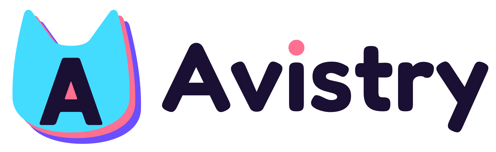
  </picture>
</h1>

  <a href="../../README.md">English</a> |
  <a href="README.ja.md">日本語</a> |
  한국어 |
  <a href="README.zh-CN.md">简体中文</a>

  VRChat 아바타의 텍스처를 Unity 안에서 색 바꾸고, 그리고, 고쳐 보세요. 
  부위를 고르고, 바꾸고, 아바타가 바뀌는 걸 확인한 뒤 새 PNG로 저장하면 됩니다. 원본은 바뀌지 않습니다.

  
  
  
  

  
  
  
  

  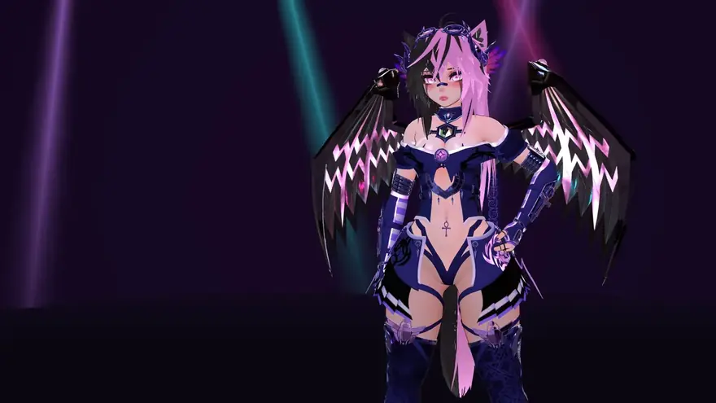
   아바타 하나, 룩 세 가지, 모두 Avistry로 만들었습니다. 원본 파일은 바뀌지 않았습니다.

## 사용 방법

네 단계, 창 하나. **Tools › Avistry › Textures**를 열고 아바타를 고르면, Scene 뷰의 아바타에 작업하는 대로 바로
반영됩니다.

<table>
  <tr>
    <td width="50%" valign="top">
      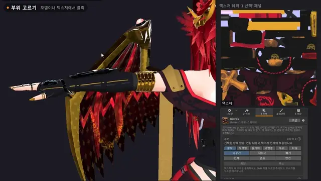
       <b>1. 부위 고르기.</b> 모델이나 텍스처에서 클릭하세요. 같은 조각이 양쪽에서 함께 밝아집니다.
    </td>
    <td width="50%" valign="top">
      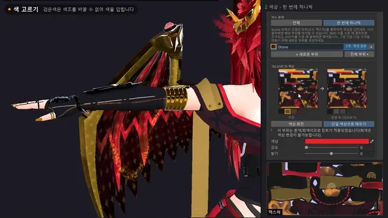
       <b>2. 색 고르기.</b> 색을 옮겨도 음영과 무늬는 제자리에 남습니다.
    </td>
  </tr>
  <tr>
    <td width="50%" valign="top">
      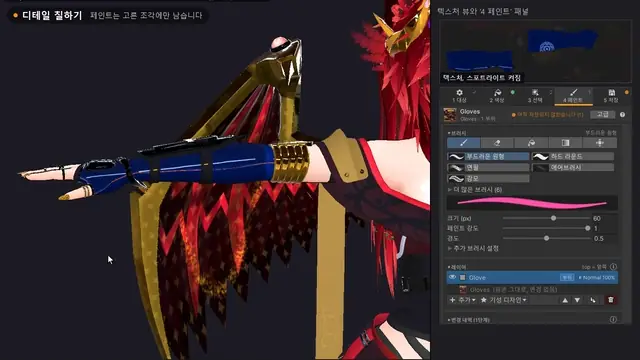
       <b>3. 디테일 칠하기.</b> 브러시와 그라데이션은 고른 조각 안에만 적용됩니다.
    </td>
    <td width="50%" valign="top">
      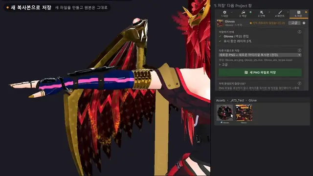
       <b>4. 새 복사본으로 저장.</b> 원본은 그대로 두고, 그 옆에 새 PNG와 머티리얼이 만들어집니다.
    </td>
  </tr>
</table>

웹사이트에서 <a href="https://avistry.github.io/avistry/#tour">3분 투어</a>를 보세요. 영어, 일본어, 한국어, 중국어 내레이션이 있습니다.

## 원하는 곳만 정확히 고르세요

아바타 텍스처는 작은 조각이 많이 모인 평평한 한 장입니다. 소매, 스트랩, 날개 같은 것들이죠. Avistry는 각 조각이 모델의
어디에 있는지 알고 있습니다. 텍스처에서 조각을 고르면 아바타에서 밝아지고, 아바타를 클릭하면 텍스처에서 밝아집니다.
이후 색, 페인트, 레이어는 고른 곳만 바꿉니다. 고르는 방법은 여섯 가지입니다.

<table>
  <tr>
    <td width="33%" valign="top">
      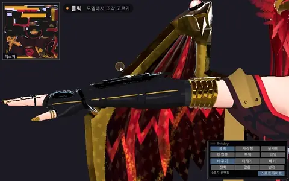
       <b>클릭.</b> 조각을 하나씩 고릅니다. Shift는 추가, Ctrl은 제외.
    </td>
    <td width="33%" valign="top">
      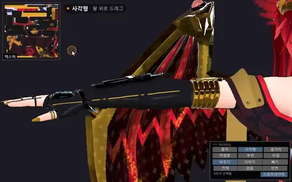
       <b>사각형.</b> 조각을 드래그로 둘러쌉니다. 텍스처에서도, 모델에서 바로도 됩니다.
    </td>
    <td width="33%" valign="top">
      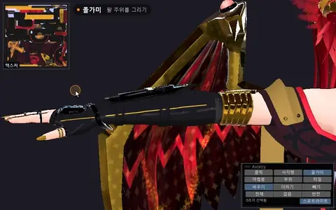
       <b>올가미.</b> 원하는 조각을 아무 모양으로나 둘러 그리세요.
    </td>
  </tr>
  <tr>
    <td width="33%" valign="top">
      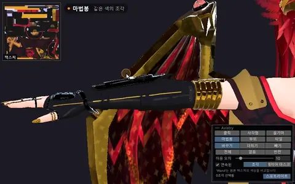
       <b>마법봉.</b> 색을 클릭하면 그 색을 가진 조각이 모두 선택됩니다.
    </td>
    <td width="33%" valign="top">
      
       <b>부위별.</b> 한 번 클릭하면 부위의 모든 조각이 선택됩니다.
    </td>
    <td width="33%" valign="top">
      
       <b>UV 타일별.</b> 타일 안의 조각을 모두 고릅니다. 여러 타일에 걸쳐 있는 아바타에 유용합니다.
    </td>
  </tr>
</table>

## 이런 걸 할 수 있어요

<table>
  <tr>
    <td width="50%" valign="top">
      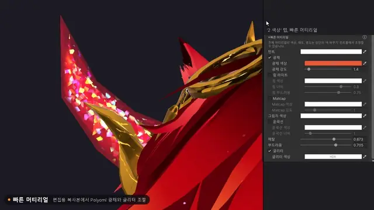
       <b>머티리얼 전체 색 바꾸기.</b> Poiyomi와 lilToon에서는 그림자, 림, 매트캡, 아웃라인, 발광 색이
      셰이더 자체 설정을 통해 함께 따라 바뀝니다.
    </td>
    <td width="50%" valign="top">
      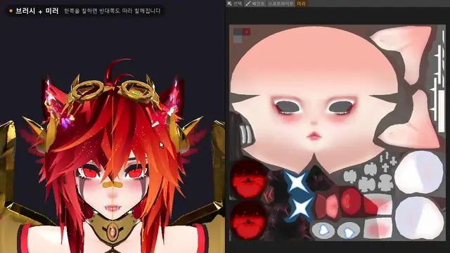
       <b>페인팅.</b> 필압을 지원하는 브러시 11종에 채우기, 그라디언트, 블러, 스머지까지 있습니다. 텍스처 위에도,
      3D 모델 위에도 바로 그릴 수 있고, 원하면 좌우 대칭으로 그려집니다.
    </td>
  </tr>
  <tr>
    <td width="50%" valign="top">
      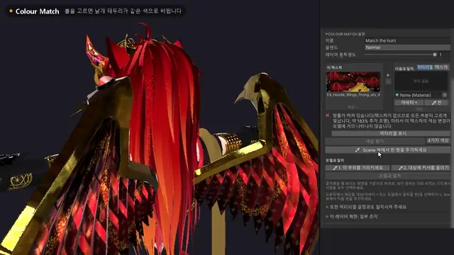
       <b>색상 일치.</b> 머리카락에 옷의 색을 입히거나 그 반대로 할 수 있고, 원래의 음영은 그대로 유지됩니다.
    </td>
    <td width="50%" valign="top">
      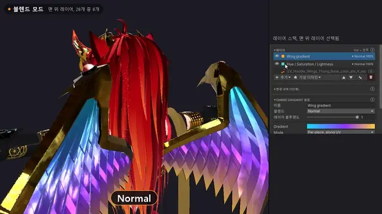
       <b>레이어 작업.</b> 합성 모드 28종, 마스크, 클리핑, 이미지 레이어, 색조 보정 레이어를 쓸 수 있습니다.
      레이어를 숨기거나, 순서를 바꾸거나, 어느 단계든 되돌릴 수 있습니다.
    </td>
  </tr>
</table>

그 밖의 기능입니다.

- **보조 맵 굽기.** 앰비언트 오클루전, 텍스처로 만든 노멀 맵, 애니메 스타일 얼굴용 페이스 섀도우 맵을 구워 줍니다.
- **머티리얼 점검.** 핑크색으로 깨진 셰이더, 빈 슬롯, 빠진 텍스처, 잘못된 임포트 설정을 쉬운 말로 설명해 주고,
  안전하게 고칠 수 있는 건 버튼 하나로 고칠 수 있습니다.
- **쓰면서 배우기.** Simple과 Advanced 모드, 정보 아이콘, 용어 65개의 용어집, Unity 입문자를 위한 스킬 트리가 있습니다.
- **내 언어로.** 도구 전체가 영어, 일본어, 한국어, 중국어 간체로 되어 있고, 기본적으로 Unity 에디터의 언어를 따릅니다.

모든 기능은 [기능 페이지](https://avistry.github.io/avistry/features.html)에 정리되어 있습니다.

<!-- site-pages:start -->
## 웹사이트 페이지 둘러보기

페이지마다 그림이 있습니다. 클릭하면 해당 페이지가 열립니다.

<table>
  <tr>
    <td width="50%" valign="top">
      <a href="https://avistry.github.io/avistry/features.html?lang=ko">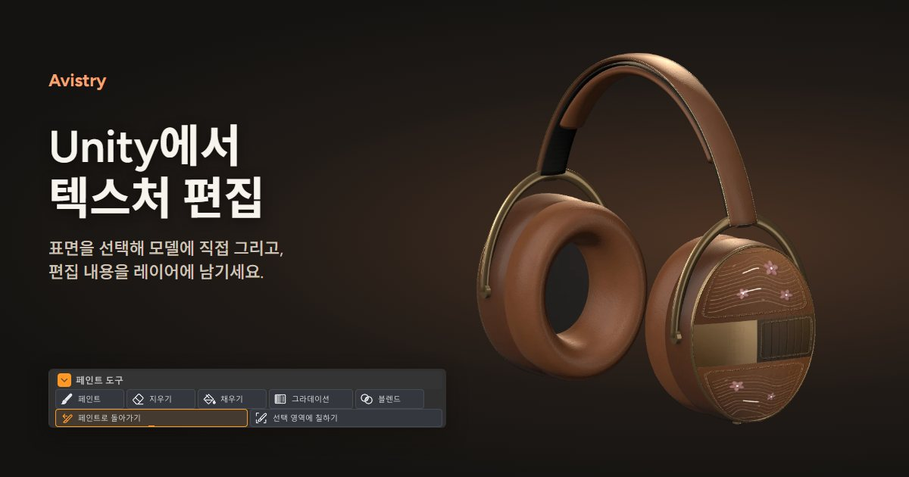</a>
       <a href="https://avistry.github.io/avistry/features.html?lang=ko"><b>기능</b></a> · 조각을 고르고, 레이어에 칠하고, 색을 바꾸고, 머티리얼을 다듬고, 맵을 베이크하세요.
    </td>
    <td width="50%" valign="top">
      <a href="https://avistry.github.io/avistry/gallery.html?lang=ko">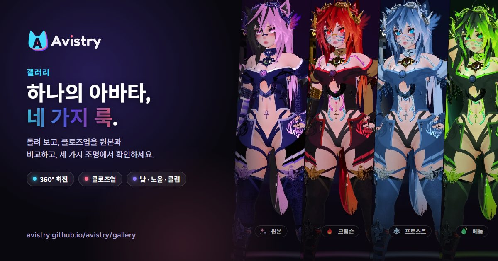</a>
       <a href="https://avistry.github.io/avistry/gallery.html?lang=ko"><b>갤러리</b></a> · 돌려 보고, 클로즈업을 원본과 비교하고, 세 가지 조명에서 확인하세요.
    </td>
  </tr>
  <tr>
    <td width="50%" valign="top">
      <a href="https://avistry.github.io/avistry/learn.html?lang=ko">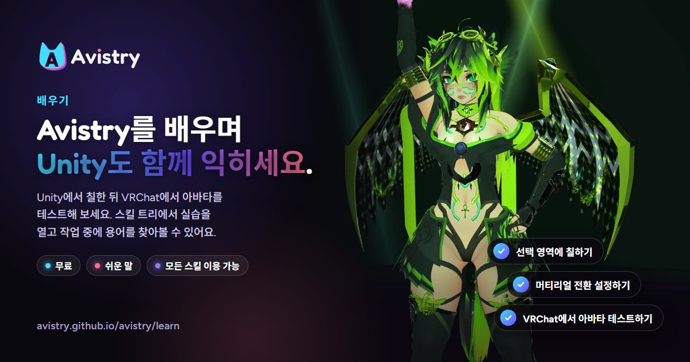</a>
       <a href="https://avistry.github.io/avistry/learn.html?lang=ko"><b>배우기</b></a> · Unity에서 칠한 뒤 VRChat에서 아바타를 테스트해 보세요. 스킬 트리에서 실습을 열고 작업 중에 용어를 찾아볼 수 있어요.
    </td>
    <td width="50%" valign="top">
      <a href="https://avistry.github.io/avistry/skills.html?lang=ko">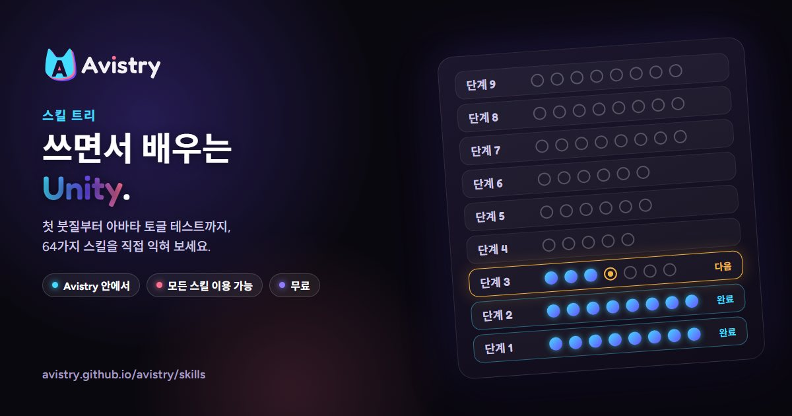</a>
       <a href="https://avistry.github.io/avistry/skills.html?lang=ko"><b>스킬 트리</b></a> · 첫 붓질부터 아바타 토글 테스트까지, 64가지 스킬을 직접 익혀 보세요.
    </td>
  </tr>
  <tr>
    <td width="50%" valign="top">
      <a href="https://avistry.github.io/avistry/glossary.html?lang=ko">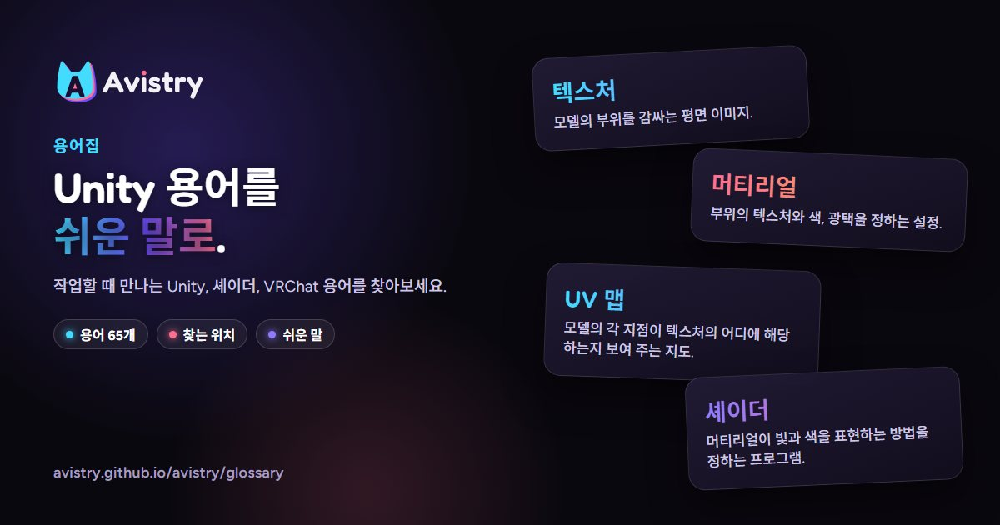</a>
       <a href="https://avistry.github.io/avistry/glossary.html?lang=ko"><b>용어집</b></a> · 작업할 때 만나는 Unity, 셰이더, VRChat 용어를 찾아보세요.
    </td>
    <td width="50%" valign="top">
      <a href="https://avistry.github.io/avistry/about.html?lang=ko">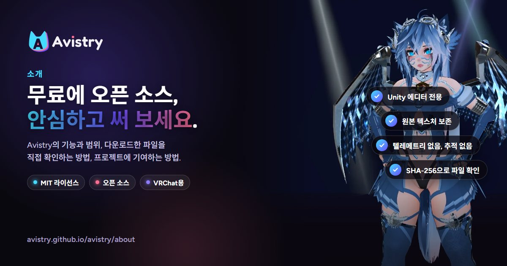</a>
       <a href="https://avistry.github.io/avistry/about.html?lang=ko"><b>소개</b></a> · Avistry의 기능과 범위, 다운로드한 파일을 직접 확인하는 방법, 프로젝트에 기여하는 방법.
    </td>
  </tr>
  <tr>
    <td width="50%" valign="top">
      <a href="https://avistry.github.io/avistry/download.html?lang=ko">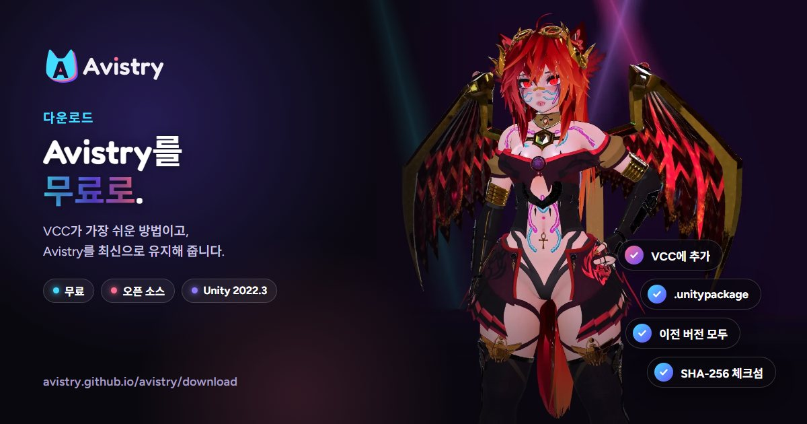</a>
       <a href="https://avistry.github.io/avistry/download.html?lang=ko"><b>다운로드</b></a> · VCC가 가장 쉬운 방법이고, Avistry를 최신으로 유지해 줍니다.
    </td>
    <td width="50%" valign="top">
      <a href="https://avistry.github.io/avistry/?lang=ko">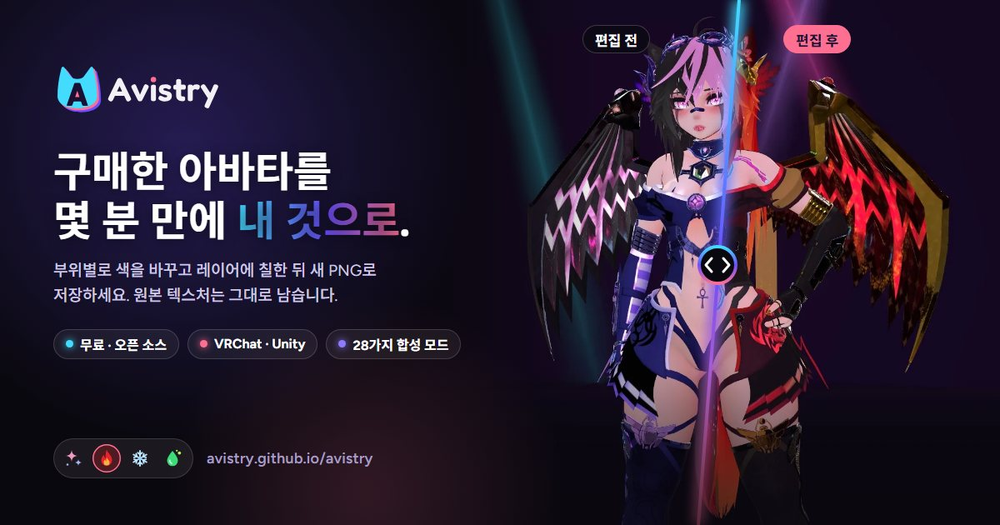</a>
       <a href="https://avistry.github.io/avistry/?lang=ko"><b>홈</b></a> · 부위별로 색을 바꾸고 레이어에 칠한 뒤 새 PNG로 저장하세요. 원본 텍스처는 그대로 남습니다.
    </td>
  </tr>
</table>
<!-- site-pages:end -->

## 왜 Avistry인가

아바타를 샀다면, Avistry는 그 아바타를 나만의 것으로 만드는 도구입니다. 정성 들여 만든 VRChat 아바타 툴킷으로, 모든 도구는 크리에이터의 실제 문제를 쉬운 말로 풀어야 하고, 내놓기 전에 완성도를 갖춰야 합니다.

- **처음부터 안전하게.** 원본을 덮어쓰지 않고, Unity 에디터 안에서만 동작하며, 데이터를 보내지 않습니다. 이건 설정이 아니라 코드에 들어 있는 규칙입니다.
- **양보다 완성도.** 거의 되는 도구 열 개보다 제대로 되는 도구 하나가 낫습니다. 화면만 복잡해지는 기능은 만들지 않습니다.
- **커뮤니티와 함께 성장.** 아이디어는 Discord에서 이야기하고, 기여는 AI 에이전트의 도움으로 만들어지는 경우가 많으며, 모든 변경은 메인테이너가 Unity에서 직접 검토하고 테스트합니다. 여기서 AI는 도구일 뿐, 작성자가 아닙니다.

  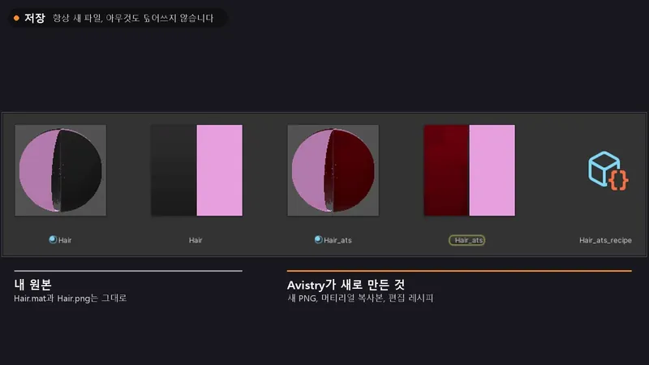
   저장하면 항상 새 파일이 만들어집니다. 원본 텍스처와 머티리얼은 그대로 남습니다.

<!-- release-banner:start -->

  <a href="https://github.com/avistry/avistry/releases/tag/v0.3.0">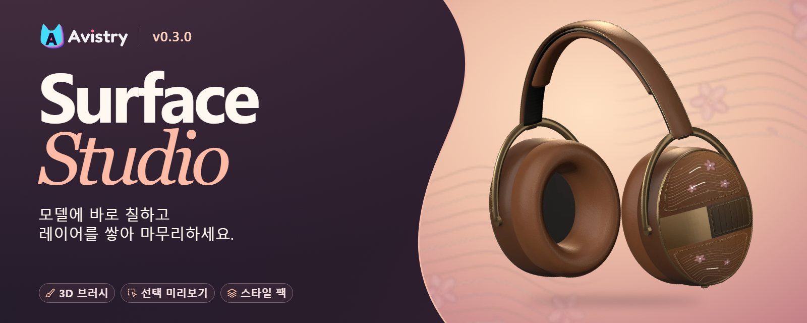</a>
   최신 버전 0.3.0 · Surface Studio · <a href="https://github.com/avistry/avistry/releases/tag/v0.3.0">릴리스 노트 읽기</a>

<!-- release-banner:end -->

## 설치

VRChat이 쓰는 Unity 2022.3이 필요합니다. 한 가지 방법을 골라서, 업데이트도 같은 방법으로 하세요.

**VRChat Creator Companion (권장).** [안내 페이지](https://avistry.github.io/avistry/)를 열고 **Add to VCC**를 누르거나,
VCC의 *Settings › Packages › Add Repository*에 `https://avistry.github.io/avistry/index.json`을 붙여 넣으세요.
그다음 *Manage Project*에서 Avistry 옆의 **+**를 누릅니다. 업데이트도 같은 곳에 표시됩니다.

**.unitypackage.** [최신 릴리스](https://github.com/avistry/avistry/releases/latest)에서 내려받아 Project 창으로
끌어다 놓으세요. 도구는 Assets가 아니라 `Packages/com.avistry.toolkit`에 들어갑니다.

**Git URL.** *Window › Package Manager*에서 **+**를 누르고 *Add package from git URL…*을 골라
`https://github.com/avistry/avistry.git`을 붙여 넣으세요.

다른 패키지는 필요 없습니다. Poiyomi나 lilToon이 설치되어 있으면 색 바꾸기 탭에 해당 셰이더용 옵션이 추가로 나타납니다.
맨 처음 테스트 빌드를 써 본 적이 있다면 먼저 `Assets/AvatarTextureStudio`를 지워 주세요(VCC로 설치하면 알아서 지워 줍니다).

## 빠른 시작

1. **Tools › Avistry › Textures**를 고르고, 아바타의 부위 하나를 선택한 뒤 텍스처를 고릅니다.
2. 빠르게 색만 바꾸려면 **색 바꾸기**를, 일부만 고르려면 **범위**에서 조각을 고른 뒤 **그리기**를 쓰세요. 작업하는 대로 아바타에 바로 반영됩니다.
3. **저장** 탭에서 **새 PNG 파일로 저장**을 누릅니다.

저장하기 전에는 아무것도 기록되지 않습니다. 편집은 Ctrl+Z로 모두 되돌릴 수 있고, 저장하지 않은 작업이 있는 채로 닫으려 하면 먼저 물어봅니다.

## 안전과 신뢰

- 코드는 전부 이 저장소에 있고 [MIT 라이선스](../../LICENSE)입니다. 에디터 전용이라서 업로드에 들어가거나 VRChat 안에서
  실행되는 것은 없습니다.
- 각 파일의 SHA-256 체크섬은 `SHA256SUMS.txt`에 있습니다. PowerShell에서
  `Get-FileHash <파일> -Algorithm SHA256`을 실행해 값을 비교하세요. VirusTotal 검사 결과가 있으면 릴리스 노트에서 확인할 수 있습니다.
- 텔레메트리는 없습니다. 네트워크를 쓰는 건 선택 기능인 업데이트 확인(도움말(?) 아이콘 › 업데이트를 자동으로 확인) 하나뿐입니다.
  켜기 전에는 꺼져 있고, 하루에 한 번 GitHub 공개 API에 최신 버전을 물어보며, 사용자에 대한 정보는 보내지 않습니다.
- 새 도구를 써 보기 전에는 프로젝트를 백업해 두세요. 이 도구도 마찬가지입니다.

<b>AI 도우미와 함께 쓰기 (선택)</b>

Avistry는 컴퓨터에 있는 AI 앱(Claude Code, Cursor, VS Code 등)과 **MCP for Unity**를 통해 함께 쓸 수 있습니다.
MCP for Unity는 다른 팀이 만든 무료 패키지이며, Avistry는 이것 없이도 모든 기능이 동작합니다.

1. *Window › Package Manager*에서 git URL로 `https://github.com/CoplayDev/unity-mcp.git?path=/MCPForUnity`를 추가합니다.
2. *Window › MCP for Unity*를 열고 AI 앱을 연결합니다. 이 컴퓨터에서 서버가 실행됩니다.
3. Avistry에서 도움말(?) 아이콘 › **AI 도우미를 연결하세요…**를 열고 **보기만** 또는 **보기와 편집**을 고릅니다. 처음에는 **꺼짐**입니다.

AI가 하는 작업 하나하나가 "AI: …"라는 이름의 Ctrl+Z 한 단계입니다. 저장과 텍스처 그림 보내기는 **허용**을 누를 때까지
실행되지 않습니다. 저희 도구는 파일을 덮어쓰거나 지우거나 코드를 실행하지 않습니다.

알아 두세요. MCP for Unity에는 자체 도구가 있고, 그중 하나는 Unity에서 임의의 코드를 실행할 수 있으니 AI 앱의 승인 확인을
켜 두세요. 부위, 머티리얼, 텍스처 이름은 사용하는 AI 서비스로 전달됩니다. MCP for Unity는 기본적으로 사용 데이터를
수집하며, 끄는 방법은 해당 문서에 있습니다.

## 자주 묻는 질문

원본 텍스처가 바뀌나요?

아니요. 저장하면 원본 옆에 새 PNG(<code>_ats.png</code>), 새 머티리얼, 저장된 편집 내용이 만들어집니다.

Poiyomi나 lilToon이 꼭 있어야 하나요?

아니요. 페인팅, 레이어, 조각 선택, 저장은 어떤 머티리얼에서든 됩니다. 셰이더 연동 색 바꾸기와 페이스 섀도우 맵은
Poiyomi나 lilToon이 필요합니다.

아바타와 함께 업로드되나요?

아니요. 직접 저장한 PNG와 머티리얼만 프로젝트의 일부가 됩니다.

백신이나 VirusTotal에서 경고가 떴어요.

내려받은 파일의 SHA-256을 릴리스의 <code>SHA256SUMS.txt</code>와 비교해 보시고, 이 저장소의 릴리스에서만 내려받으세요.
에디터 스크립트는 한두 개 엔진에서 오탐이 나기도 합니다. 그래도 이상하면 검사 결과 링크와 함께 이슈를 열어 주세요.

테스트 빌드라고 나오는데, 안정적인가요?

<code>0.</code>으로 시작하는 버전은 테스트 빌드입니다. 동작은 하지만 아직 바뀌는 부분이 있습니다. 먼저 프로젝트를
백업해 두시고, 겪은 일이 있으면 알려 주세요.

어떻게 지우나요?

VCC에서는 패키지 옆 <b>−</b>를 누르세요. 다른 방법으로 설치했다면 <code>Packages/com.avistry.toolkit</code>를
지우면 됩니다. 직접 저장한 파일은 남습니다.

## 이 도구는 어떻게 만들어졌나

아바타 크리에이터분들이 도구를 써 보고 뭐가 되고 뭐가 안 되는지 알려 주셨고, 저희는 그 의견대로 도구를 고쳤습니다.
AI는 의도적으로 씁니다. 더 빨리 만들고, 보안 문제와 버그를 점검하기 위해서이며, 경험 있는 C# 개발자가 코드를 읽고
확인합니다. 실제 Unity 에디터를 직접 조작하는 자동 기능 테스트, 컴파일 검사, 스크린샷을 갖춘 자체 테스트 하네스도 있습니다.
이 중 어느 것도 완벽을 보장하지는 않으니, 문제를 발견하시면 [이슈를 열어 주세요](https://github.com/avistry/avistry/issues).

## 기여하기

풀 리퀘스트는 언제든 환영입니다. 새 기능은 먼저 [Discord](https://discord.gg/sSeWgDJJjY)에서 메인테이너와 의논합니다. 언제든 들어와 주세요. 버그 신고, 기능 요청, 수정을 보내는 방법은 [기여 가이드](../../.github/CONTRIBUTING.md)에 있습니다.

| 폴더 | 들어 있는 것 |
|---|---|
| [`Editor/`](../../Editor) | 도구 본체: C#과 셰이더. 배포되는 건 이것뿐입니다. |
| [`Website~/`](../../Website~) | 웹사이트. |
| [`.github/`](../../.github) | [기여 가이드](../../.github/CONTRIBUTING.md), [보안 정책](../../.github/SECURITY.md), 번역된 README, 릴리스 워크플로. |

## 크레딧과 라이선스

Avistry contributors가 [MIT 라이선스](../../LICENSE)로 만들었습니다. 모든 버전은 [변경 내역](../../CHANGELOG.md)에 정리되어 있습니다.
일부 합성 모드 공식은 TextureCraft(MIT)에서 가져와 고쳐 썼으며, 자세한 내용은
[서드파티 고지](../../Third%20Party%20Notices.md)에 있습니다. Poiyomi Toon Shader, lilToon, VRChat SDK는 포함되어 있지 않으며
각 제작자의 소유입니다. 이 프로젝트는 VRChat Inc.와 관련이 없습니다.
