<h1 align="center">
  <picture>
    <source media="(prefers-color-scheme: dark)" srcset="../../Website~/media/lockup.svg">
    
  </picture>
</h1>

  <a href="../../README.md">English</a> |
  <a href="README.ja.md">日本語</a> |
  <a href="README.ko.md">한국어</a> |
  简体中文

  在 Unity 里给你的 VRChat 模型换色、绘制、修补贴图。 
  选一个部位，改一改，看着模型实时更新，再存成新的 PNG。你的原图不会被改动。

  
  
  
  

  
  
  
  

  
   一个模型，三种外观，全都在 Avistry 里完成。原始文件从未改动。

## 工作方式

四步，一个窗口。打开 **Tools › Avistry › Textures**，选好你的模型，Scene 视图里的模型会随着你的每一步操作实时更新。

<table>
  <tr>
    <td width="50%" valign="top">
      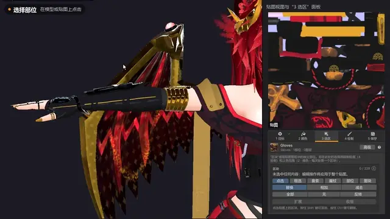
       <b>1. 选择部位。</b>在模型或贴图上点一下，同样的区块会在两边一起亮起。
    </td>
    <td width="50%" valign="top">
      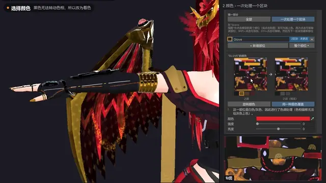
       <b>2. 选择颜色。</b>改变颜色，明暗和图案保持原位。
    </td>
  </tr>
  <tr>
    <td width="50%" valign="top">
      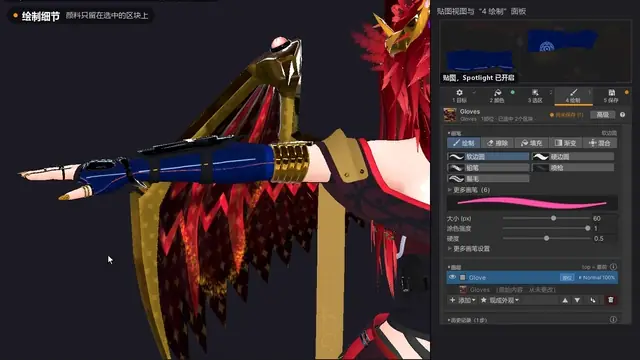
       <b>3. 绘制细节。</b>画笔和渐变只作用在你选中的区块内。
    </td>
    <td width="50%" valign="top">
      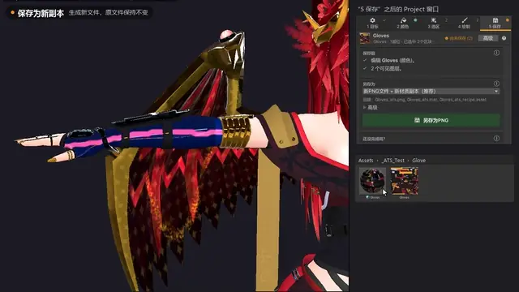
       <b>4. 保存为新副本。</b>新的 PNG 和材质会放在原文件旁边，原文件保持原样。
    </td>
  </tr>
</table>

在网站上<a href="https://avistry.github.io/avistry/#tour">观看 3 分钟导览</a>，配有英语、日语、韩语和中文旁白。

## 想选哪里，就精确选哪里

一张模型贴图是一大张平面，上面有许多小区块：一只袖子、一条肩带、一片翅膀。Avistry 知道每个区块在模型上的位置。在贴图上选一个，它就会在模型上亮起；点一下模型，它也会在贴图上亮起。之后的颜色、绘制和图层，只会改动你选中的部分。一共有六种选择方式：

<table>
  <tr>
    <td width="33%" valign="top">
      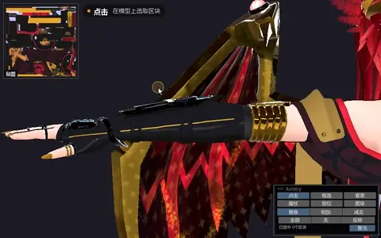
       <b>点击。</b>一次选一个区块。Shift 添加，Ctrl 移除。
    </td>
    <td width="33%" valign="top">
      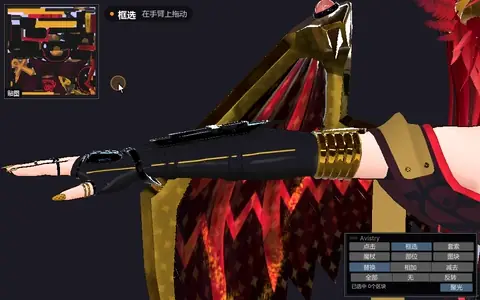
       <b>框选。</b>拖拽圈住区块，可以在贴图上，也可以直接在模型上。
    </td>
    <td width="33%" valign="top">
      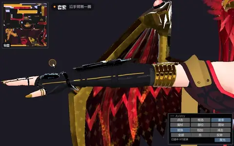
       <b>套索。</b>围着想要的区块画出任意形状。
    </td>
  </tr>
  <tr>
    <td width="33%" valign="top">
      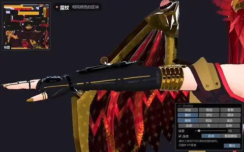
       <b>魔棒。</b>点一种颜色，就会选中所有含该颜色的区块。
    </td>
    <td width="33%" valign="top">
      
       <b>按部位。</b>单击一下，就选中某个部位的所有区块。
    </td>
    <td width="33%" valign="top">
      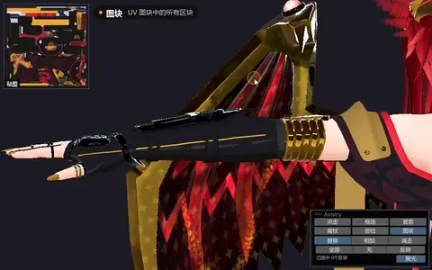
       <b>按 UV 图块。</b>选中一个图块内的全部区块，适合分布在多个图块上的模型。
    </td>
  </tr>
</table>

## 它还能做什么

<table>
  <tr>
    <td width="50%" valign="top">
      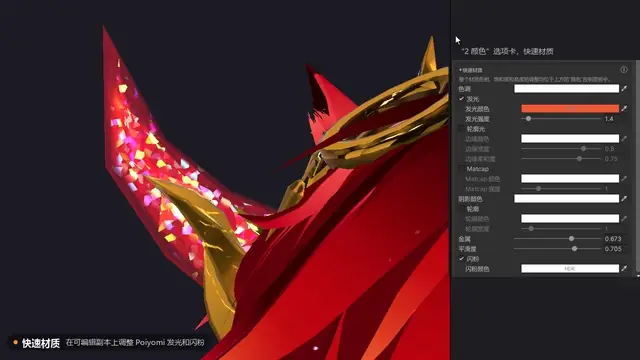
       <b>整个材质换色。</b>在 Poiyomi 和 lilToon 上，阴影、边缘光、Matcap、描边和自发光的颜色会跟着一起变，
      走的是着色器自带的设置。
    </td>
    <td width="50%" valign="top">
      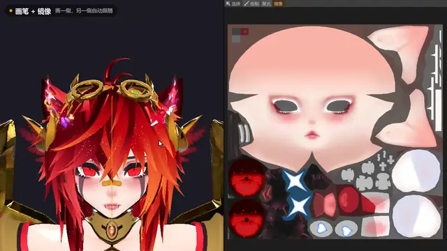
       <b>绘制。</b>11 种画笔，支持压感，另有填充、渐变、模糊和涂抹。可以画在贴图上，也可以直接画在 3D 模型上，
      需要的话还能镜像。
    </td>
  </tr>
  <tr>
    <td width="50%" valign="top">
      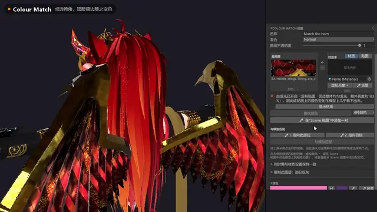
       <b>匹配颜色。</b>让头发用上衣服的配色，或者反过来，同时保留原来的明暗。
    </td>
    <td width="50%" valign="top">
      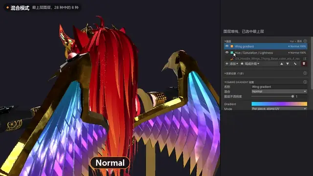
       <b>用图层工作。</b>28 种混合模式、蒙版、剪贴、图片图层和调整图层。任何一步都能隐藏、调整顺序或撤销。
    </td>
  </tr>
</table>

还有这些：

- **烘焙辅助贴图。**环境光遮蔽、由贴图生成的法线贴图，还有给动漫风脸部用的脸部阴影图。
- **检查材质。**粉红色着色器、空槽位、缺失的贴图和不对的导入设置，都用大白话讲清楚，能安全修复的地方有一键修复按钮。
- **边用边学。**有 Simple 和 Advanced 两种模式、信息图标、41 个词条的术语表，还有给 Unity 新手的技能树。
- **你的语言。**整个工具支持英语、日语、韩语和简体中文，默认跟随 Unity 编辑器的语言。

所有功能都列在[功能页面](https://avistry.github.io/avistry/features.html)里。

<!-- site-pages:start -->
## 网站各页面一览

每个页面都有自己的图片，点击即可打开该页面。

<table>
  <tr>
    <td width="50%" valign="top">
      <a href="https://avistry.github.io/avistry/features.html?lang=zh-CN">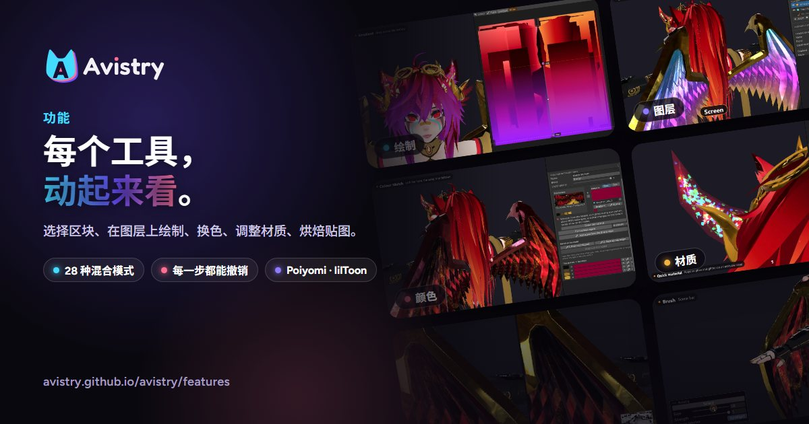</a>
       <a href="https://avistry.github.io/avistry/features.html?lang=zh-CN"><b>功能</b></a> · 选择区块、在图层上绘制、换色、调整材质、烘焙贴图。
    </td>
    <td width="50%" valign="top">
      <a href="https://avistry.github.io/avistry/gallery.html?lang=zh-CN">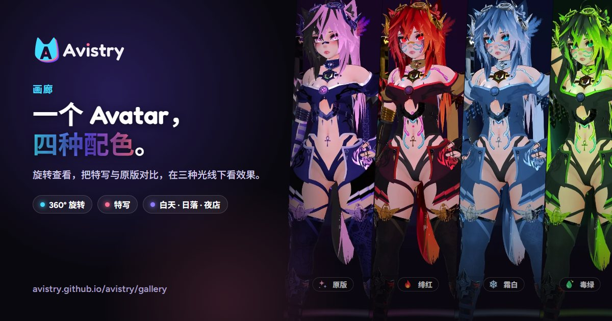</a>
       <a href="https://avistry.github.io/avistry/gallery.html?lang=zh-CN"><b>画廊</b></a> · 旋转查看，把特写与原版对比，在三种光线下看效果。
    </td>
  </tr>
  <tr>
    <td width="50%" valign="top">
      <a href="https://avistry.github.io/avistry/learn.html?lang=zh-CN">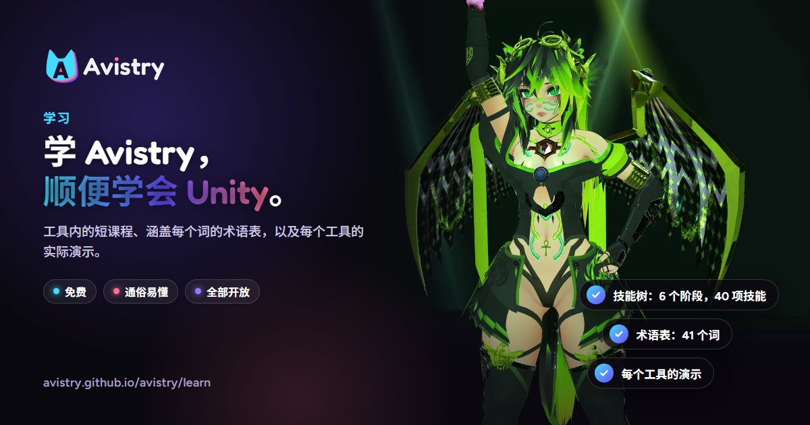</a>
       <a href="https://avistry.github.io/avistry/learn.html?lang=zh-CN"><b>学习</b></a> · 工具内的短课程、涵盖每个词的术语表，以及每个工具的实际演示。
    </td>
    <td width="50%" valign="top">
      <a href="https://avistry.github.io/avistry/skills.html?lang=zh-CN">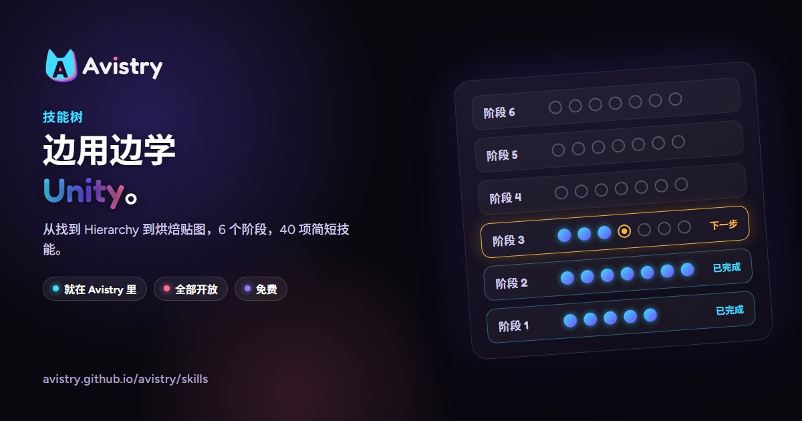</a>
       <a href="https://avistry.github.io/avistry/skills.html?lang=zh-CN"><b>技能树</b></a> · 从找到 Hierarchy 到烘焙贴图，6 个阶段，40 项简短技能。
    </td>
  </tr>
  <tr>
    <td width="50%" valign="top">
      <a href="https://avistry.github.io/avistry/glossary.html?lang=zh-CN">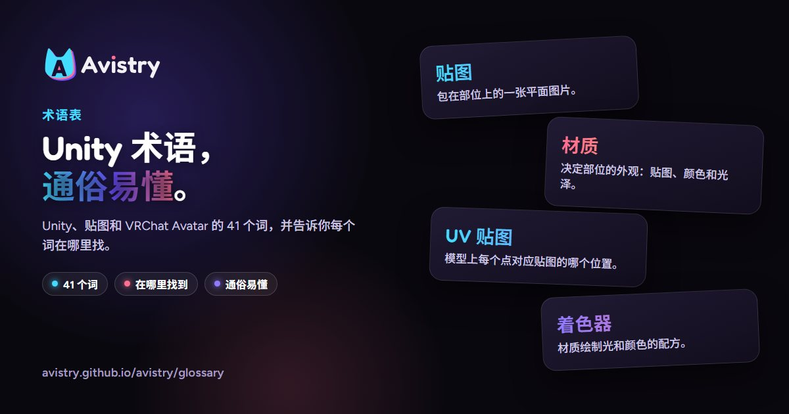</a>
       <a href="https://avistry.github.io/avistry/glossary.html?lang=zh-CN"><b>术语表</b></a> · Unity、贴图和 VRChat Avatar 的 41 个词，并告诉你每个词在哪里找。
    </td>
    <td width="50%" valign="top">
      <a href="https://avistry.github.io/avistry/about.html?lang=zh-CN">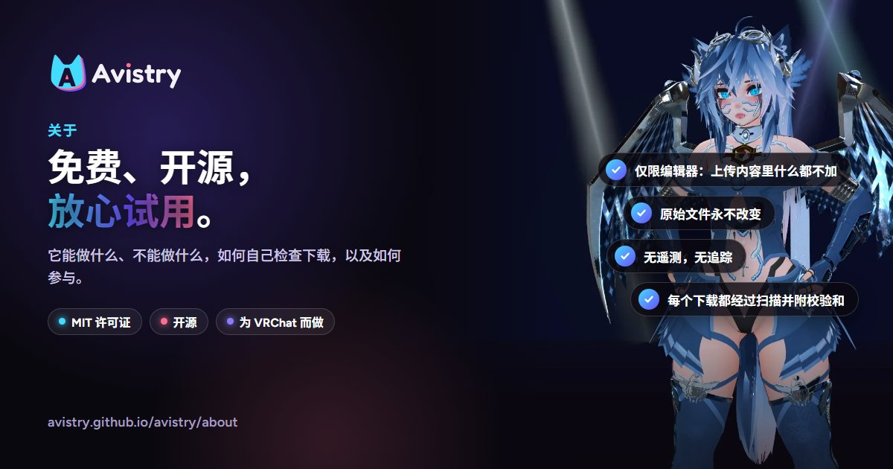</a>
       <a href="https://avistry.github.io/avistry/about.html?lang=zh-CN"><b>关于</b></a> · 它能做什么、不能做什么，如何自己检查下载，以及如何参与。
    </td>
  </tr>
  <tr>
    <td width="50%" valign="top">
      <a href="https://avistry.github.io/avistry/download.html?lang=zh-CN">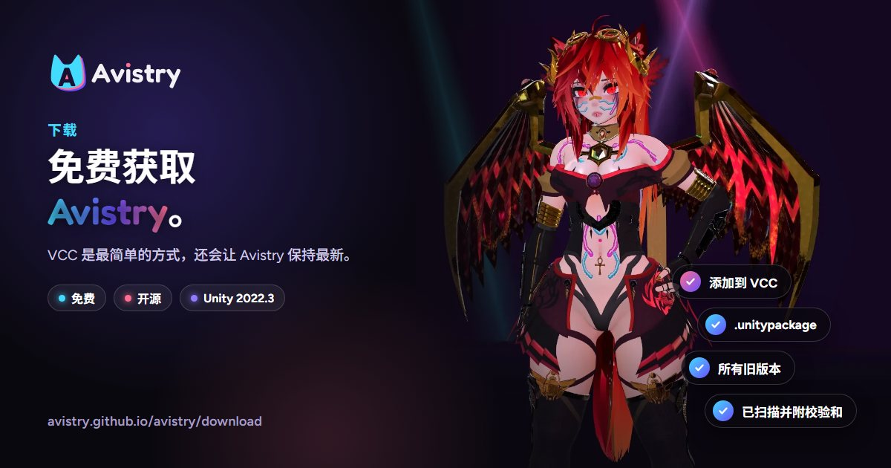</a>
       <a href="https://avistry.github.io/avistry/download.html?lang=zh-CN"><b>下载</b></a> · VCC 是最简单的方式，还会让 Avistry 保持最新。
    </td>
    <td width="50%" valign="top">
      <a href="https://avistry.github.io/avistry/?lang=zh-CN">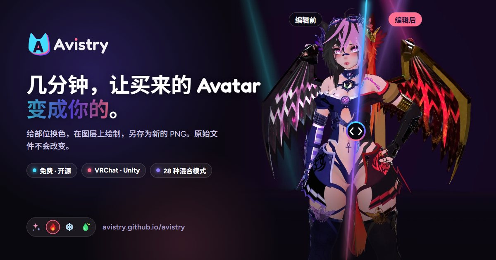</a>
       <a href="https://avistry.github.io/avistry/?lang=zh-CN"><b>首页</b></a> · 给部位换色，在图层上绘制，另存为新的 PNG。原始文件不会改变。
    </td>
  </tr>
</table>
<!-- site-pages:end -->

## 为什么选 Avistry

你买下了一个模型，Avistry 能让它变成你自己的。这是一个用心打造的 VRChat 模型工具包：每个工具都要用大白话解决创作者的真实问题，并且在发布前就已经做到完善、好用。

- **从设计上就安全。**它不会覆盖你的原图，只在 Unity 编辑器里运行，也不发送任何数据。这些是写在代码里的规则，不是设置项。
- **精工胜过数量。**一个真正好用的工具，胜过十个差不多能用的。我们会拒绝只会增加杂乱的功能。
- **和社区一起成长。**想法在 Discord 上讨论，贡献常常借助 AI 代理完成，维护者会在 Unity 里审查并测试每一处改动。在这里，AI 是工具，从来不是作者。

  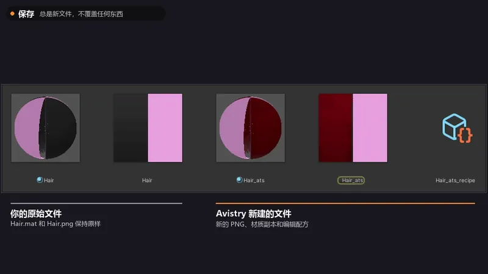
   保存总是生成新文件。原来的贴图和材质保持原样。

<!-- release-banner:start -->

  <a href="https://github.com/avistry/avistry/releases/tag/v0.2.0">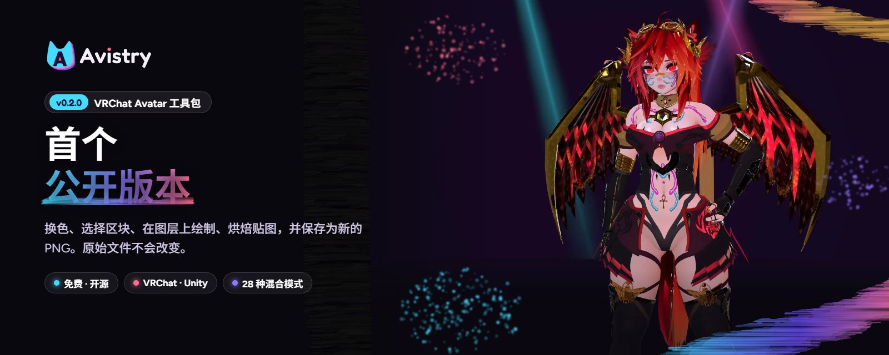</a>
   最新版本 0.2.0 · <a href="https://github.com/avistry/avistry/releases/tag/v0.2.0">阅读发布说明</a>

<!-- release-banner:end -->

## 安装

你需要 Unity 2022.3，也就是 VRChat 使用的版本。选一种方式，之后更新也一直用这种。

**VRChat Creator Companion（推荐）。**打开[我们的页面](https://avistry.github.io/avistry/)，点 **Add to VCC**，
或者在 VCC 的 *Settings › Packages › Add Repository* 里粘贴 `https://avistry.github.io/avistry/index.json`。
然后在 *Manage Project* 里点 Avistry 旁边的 **+**。更新也会出现在那里。

**.unitypackage。**从[最新发布](https://github.com/avistry/avistry/releases/latest)下载，拖进 Project 窗口。
工具会装到 `Packages/com.avistry.toolkit`，不在 Assets 下面。

**Git URL。**在 *Window › Package Manager* 里点 **+**，选 *Add package from git URL…*，然后粘贴
`https://github.com/avistry/avistry.git`。

不需要其他包。如果装了 Poiyomi 或 lilToon，**换色**标签页会多出针对它们的选项。
如果你试过最早的测试版，请先删除 `Assets/AvatarTextureStudio`（VCC 会替你删掉）。

## 快速上手

1. 选 **Tools › Avistry › Textures**，选中模型的某个部位，再挑出要编辑的贴图。
2. 想快速换色就用 **换色**，或者先在 **范围** 里选一块，再用 **绘制** 来画。模型会随着你的操作实时更新。
3. 在 **保存** 里点 **另存为PNG**。

保存之前不会写入任何东西。Ctrl+Z 可以撤销每一步编辑，带着未保存的内容关闭窗口时会先问你。

## 安全与信任

- 代码全部都在这里，采用 [MIT 许可证](../../LICENSE)。它只在编辑器里运行：不会有任何东西进入你的上传包，也不会在 VRChat 里运行。
- 每个发布文件都扫描过 VirusTotal，SHA-256 校验值列在 `SHA256SUMS.txt` 里。在 PowerShell 里用
  `Get-FileHash <文件> -Algorithm SHA256` 就能核对下载的文件。
- 没有遥测。唯一的网络请求是可选的更新检查（帮助 › 自动检查更新）。它默认关闭，
  开启后每天只向 GitHub 的公开 API 询问一次最新版本，不会发送任何关于你的信息。
- 试用任何新工具之前，包括这个，都请先备份项目。

<b>搭配 AI 助手使用（可选）</b>

Avistry 可以通过 **MCP for Unity** 与你电脑上的 AI 应用（如 Claude Code、Cursor 或 VS Code）配合使用。
MCP for Unity 是另一个团队制作的免费包。没有它，Avistry 的所有功能照常可用。

1. 在 *Window › Package Manager* 里，用 git URL 添加 `https://github.com/CoplayDev/unity-mcp.git?path=/MCPForUnity`。
2. 打开 *Window › MCP for Unity*，连接你的 AI 应用。它会在这台电脑上运行一个服务器。
3. 在 Avistry 里打开 **帮助 › 连接一个 AI 助手…**，选择 **仅查看** 或 **查看并编辑**。默认是 **关闭**。

AI 的每个操作都是一步名为“AI: …”的 Ctrl+Z。保存，以及把你的贴图图片发出去，都要等你点 **允许** 才会进行。
我们的工具不会覆盖你的文件、删除文件或运行代码。

请注意：MCP for Unity 有它自己的工具，其中一个可以在 Unity 里运行任意代码，所以请保持 AI 应用的批准提示开启。
部位、材质和贴图的名称会发送给你使用的 AI 服务。MCP for Unity 默认会收集使用数据，关闭方法见它的文档。

## 常见问题

会改动我的原始贴图吗？

不会。保存会在原文件旁边生成一张新的 PNG（<code>_ats.png</code>）、一个新的材质和一份保存好的编辑配方。

一定要有 Poiyomi 或 lilToon 吗？

不用。绘制、图层、选择某一块和保存，在任何材质上都能用。针对着色器的换色和脸部阴影图需要 Poiyomi 或 lilToon。

它会随模型一起上传吗？

不会。只有你保存下来的 PNG 和材质会成为项目的一部分。

我的杀毒软件或 VirusTotal 报了警。

把你下载文件的 SHA-256 和发布页里的 <code>SHA256SUMS.txt</code> 对一下，并且只从这个仓库的发布页下载。
编辑器脚本偶尔会被一两个引擎误报。如果还是觉得不对，请提一个 issue，并附上扫描链接。

写着测试版，稳定吗？

以 <code>0.</code> 开头的版本都是测试版。能正常使用，但还会有变化。请先备份项目，遇到的问题也欢迎告诉我们。

怎么卸载？

在 VCC 里，点包旁边的 <b>−</b>。其他安装方式，删除 <code>Packages/com.avistry.toolkit</code> 即可。
你自己保存的文件会留着。

## 这是怎么做出来的

做模型的创作者试用了这个工具，告诉我们哪里好用，我们再据此修改。我们是有意使用 AI 的，
用它来做得更快，也用它检查安全问题和 bug，之后还有一位经验丰富的 C# 开发者阅读并检查代码。
我们自己的测试框架会驱动真实的 Unity 编辑器，跑自动化的功能测试、编译检查和截图。
这些都不是保证，所以如果你发现了问题，请[提一个 issue](https://github.com/avistry/avistry/issues)。

## 参与贡献

欢迎提交 Pull Request。新功能请先在 [Discord](https://discord.gg/sSeWgDJJjY) 上和维护者讨论，欢迎加入。如何报告问题、提出功能建议或提交修复，请看[贡献指南](../../.github/CONTRIBUTING.md)。

| 文件夹 | 里面有什么 |
|---|---|
| [`Editor/`](../../Editor) | 工具本体：C# 和着色器。发布的只有这一部分。 |
| [`Website~/`](../../Website~) | 网站。 |
| [`.github/`](../../.github) | [贡献指南](../../.github/CONTRIBUTING.md)、[安全政策](../../.github/SECURITY.md)、各语言的 README、发布工作流。 |

## 致谢与许可证

由 Avistry contributors 制作，以 [MIT 许可证](../../LICENSE)发布。每个版本都列在[更新日志](../../CHANGELOG.md)里。
部分混合模式公式改编自 TextureCraft（MIT），详情见[第三方声明](../../Third%20Party%20Notices.md)。
Poiyomi Toon Shader、lilToon 和 VRChat SDK 不包含在本项目中，版权归各自作者所有。本项目与 VRChat Inc. 没有隶属关系。
