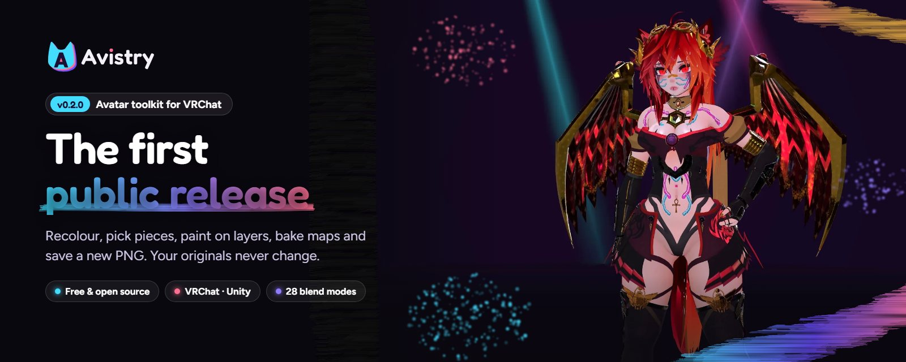
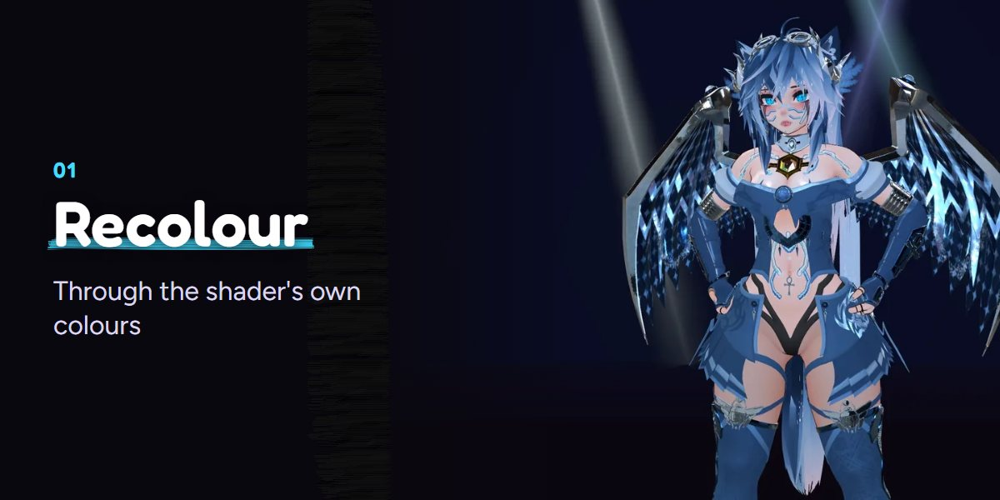
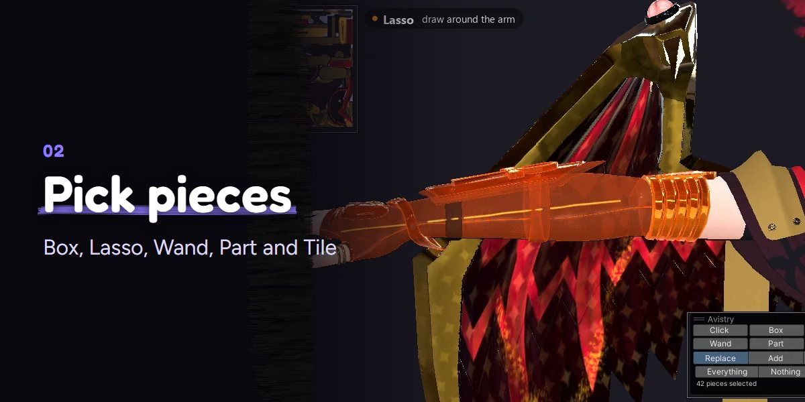
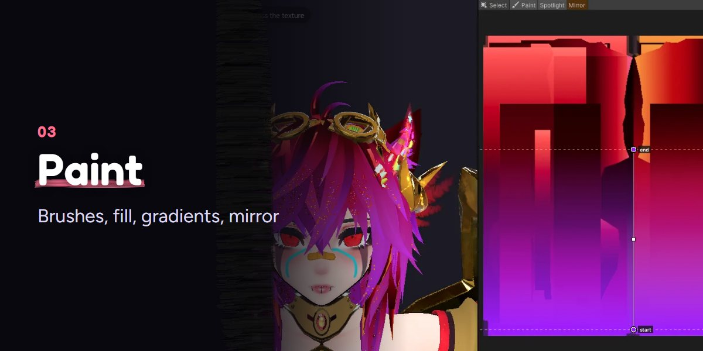
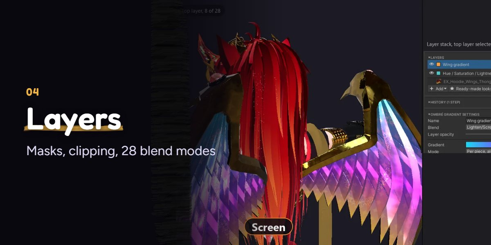
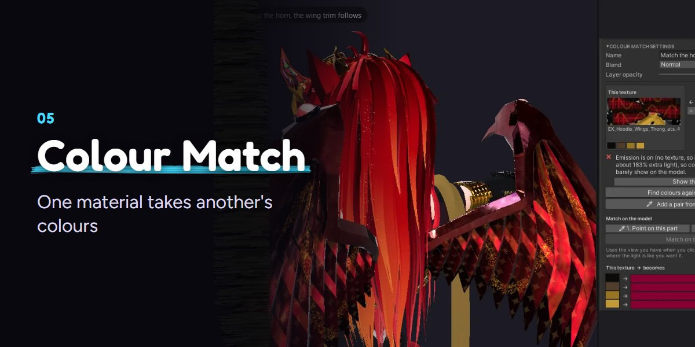
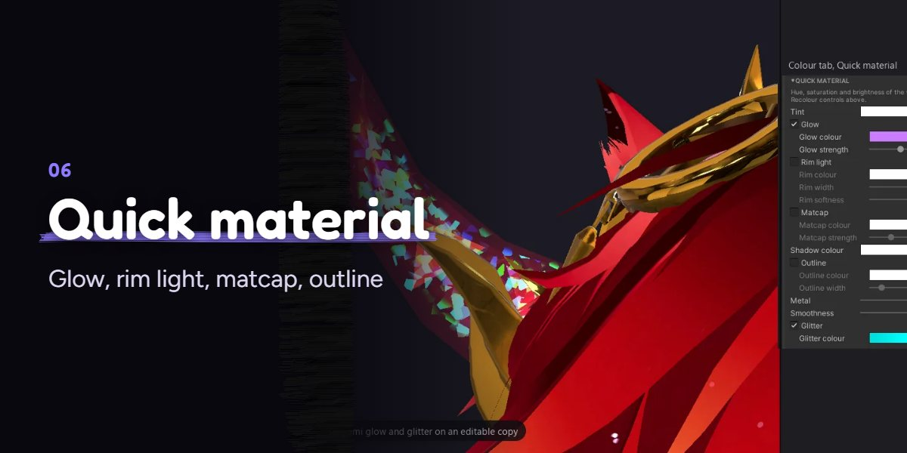
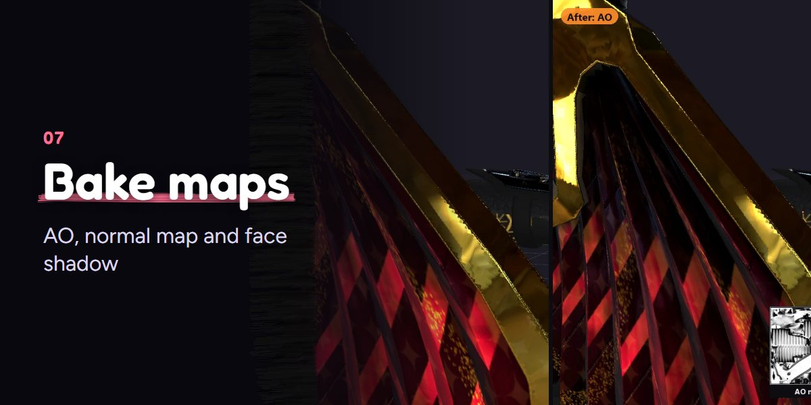
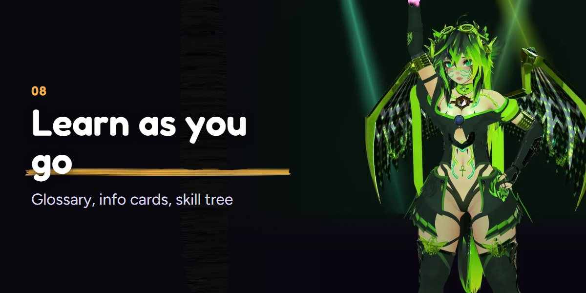

  

  <a href="https://avistry.github.io/avistry/"><b>Add to VCC</b></a> ·
  <a href="#downloads-and-verification"><b>Download</b></a> ·
  <a href="https://avistry.github.io/avistry/features.html"><b>Every feature</b></a> ·
  <a href="https://avistry.github.io/avistry/#tour"><b>Three-minute tour</b></a> ·
  <a href="https://discord.gg/sSeWgDJJjY"><b>Discord</b></a>

<table>
  <tr>
    <td width="50%"></td>
    <td width="50%"></td>
  </tr>
  <tr>
    <td width="50%"></td>
    <td width="50%"></td>
  </tr>
  <tr>
    <td width="50%"></td>
    <td width="50%"></td>
  </tr>
  <tr>
    <td width="50%"></td>
    <td width="50%"></td>
  </tr>
</table>
