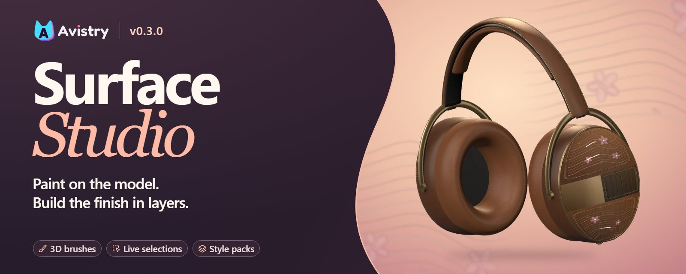
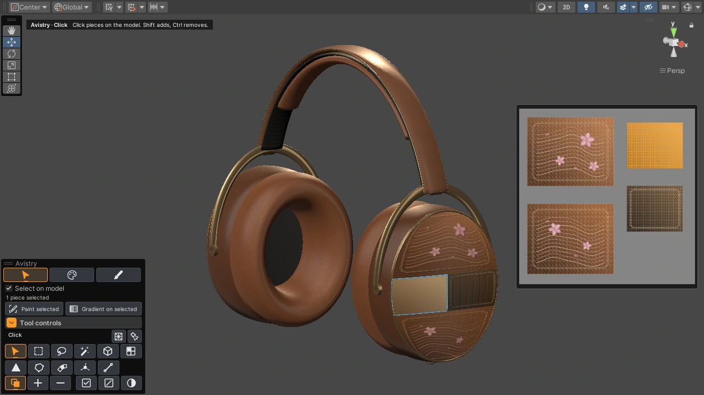
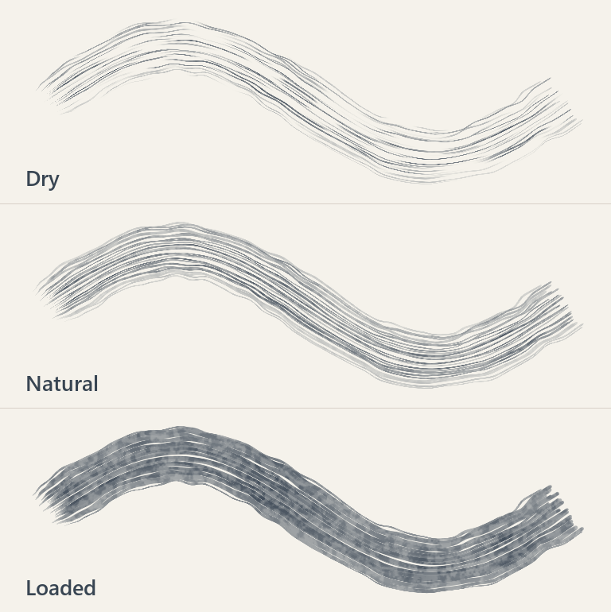
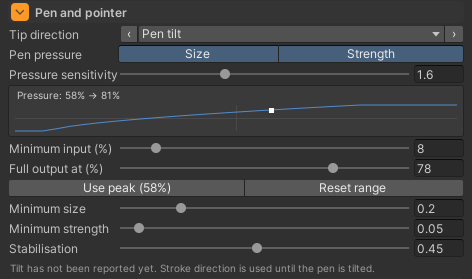
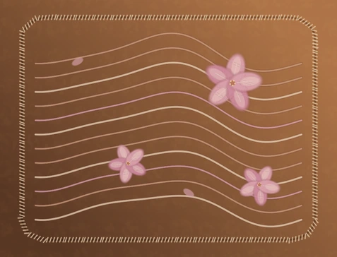
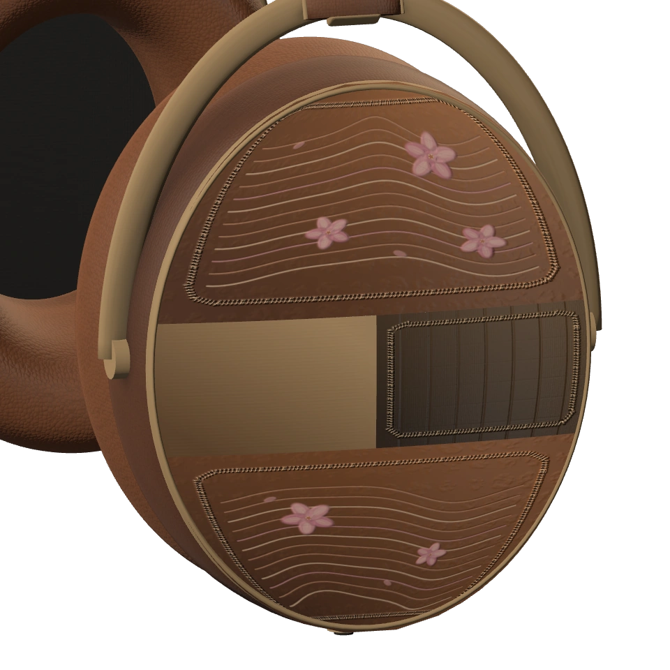
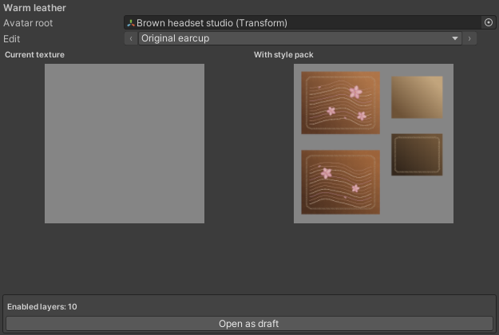

<!-- release-subtitle -->

[Install with VCC](https://avistry.github.io/avistry/download.html#install) · [Feature highlights](#highlights) · [Compatibility](#compatibility) · [Downloads and verification](#downloads-and-verification)

### In the editor

**Pick a piece on the model, then paint inside it.** The outlined metal panel on the earcup is highlighted in gold on the UV map. Switch from Select to Paint to keep working on that piece, or return to it after editing another mesh.

[Watch box and lasso selection in Unity](https://avistry.github.io/avistry/features.html?view=overview#mesh-selection) · [See a gradient inside one piece](https://raw.githubusercontent.com/avistry/avistry/v0.3.0/.github/release/screenshots/headset-selected-gradient.png)

<strong>Brushes and pens</strong> · Compare three bristle loads

Dry bristles leave gaps between strands. Loaded bristles lay down a denser stroke. Use the pressure curve to set how a light or firm press affects size and strength.

[See the brush shape picker](https://raw.githubusercontent.com/avistry/avistry/v0.3.0/Website~/media/v4/studio/brush-shapes-panel.webp) · [Set up a pen in Unity](https://avistry.github.io/avistry/skills.html#sk-pen-pressure)

<strong>Layers and materials</strong> · From painted texture to surface relief

The wave pattern, stitching and cherry blossoms are visible on the flat texture. A normal map turns the painted detail into ridges that catch the light on the earcup.

[Explore the layer stack](https://avistry.github.io/avistry/features.html#layers) · [Compare the normal map on and off](https://avistry.github.io/avistry/features.html#material) · [See Apply to material in Unity](https://raw.githubusercontent.com/avistry/avistry/v0.3.0/Website~/media/v4/studio/bake-apply-panel.webp)

<strong>Drafts and sharing</strong> · Preview a style pack

Pack and Share carries the editable layers and added artwork. The recipient supplies the original assets and can preview the result, check for missing artwork and reopen the edit as a draft.

[See the draft browser](https://raw.githubusercontent.com/avistry/avistry/v0.3.0/Website~/media/v4/studio/draft-browser.webp) · [Watch the save workflow](https://avistry.github.io/avistry/features.html#safety)

<!-- release-notes -->
