<h1 align="center">
  <picture>
    <source media="(prefers-color-scheme: dark)" srcset="Website~/media/lockup.svg">
    
  </picture>
</h1>

  English |
  <a href=".github/i18n/README.ja.md">日本語</a> |
  <a href=".github/i18n/README.ko.md">한국어</a> |
  <a href=".github/i18n/README.zh-CN.md">简体中文</a>

  Recolour, paint and fix your VRChat avatar's textures inside Unity. 
  Pick a part, change it, watch the avatar update, save a new PNG. Your original never changes.

  
  
  
  

  
  
  
  

  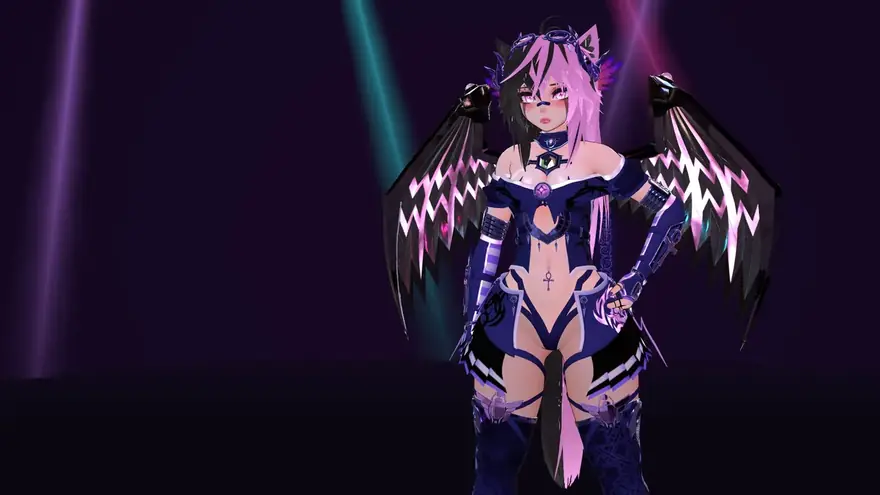
   One avatar, three looks, all made in Avistry. The original files never changed.

## How it works

Four steps, one window. Open **Tools › Avistry › Textures**, pick your avatar, and the avatar in the Scene view shows
every change as you make it.

<table>
  <tr>
    <td width="50%" valign="top">
      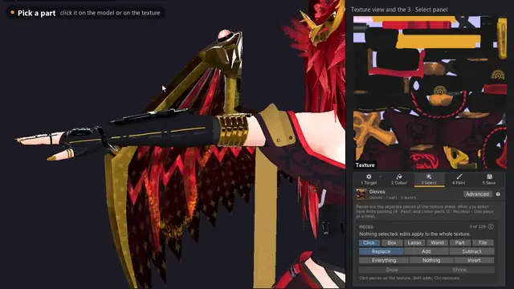
       <b>1. Pick a part.</b> Click it on the model or on the texture. The same pieces light up in both.
    </td>
    <td width="50%" valign="top">
      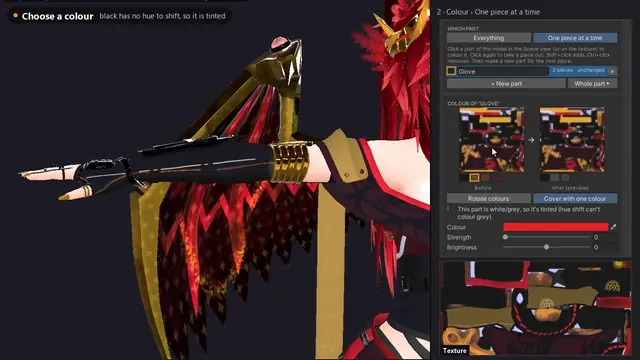
       <b>2. Choose a colour.</b> Shift the colour. Shading and patterns stay where they were.
    </td>
  </tr>
  <tr>
    <td width="50%" valign="top">
      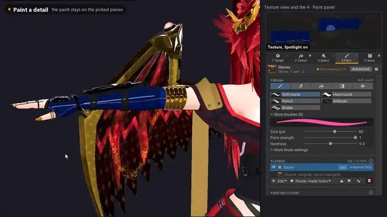
       <b>3. Paint a detail.</b> Brushes and gradients, kept inside the pieces you picked.
    </td>
    <td width="50%" valign="top">
      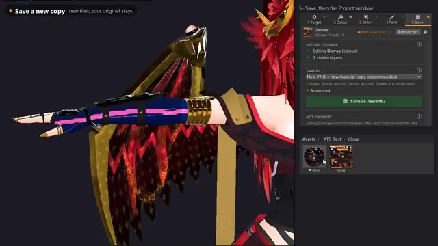
       <b>4. Save a new copy.</b> A new PNG and material next to your originals, which stay as they were.
    </td>
  </tr>
</table>

<a href="https://avistry.github.io/avistry/#tour">Watch the three-minute tour</a> on the website, with voice-over in English, Japanese, Korean and Chinese.

## Select exactly what you mean

An avatar texture is a flat sheet of many small pieces: a sleeve, a strap, a wing. Avistry knows where each piece sits
on the model. Pick one on the texture and it lights up on the avatar, or click the avatar and it lights up on the
texture. Colour, paint and layers then change only what you picked. There are six ways to pick:

<table>
  <tr>
    <td width="33%" valign="top">
      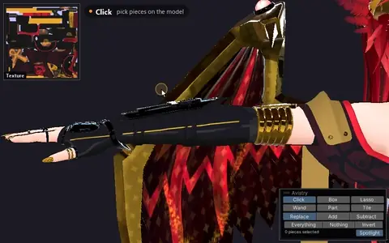
       <b>Click.</b> One piece at a time. Shift adds, Ctrl removes.
    </td>
    <td width="33%" valign="top">
      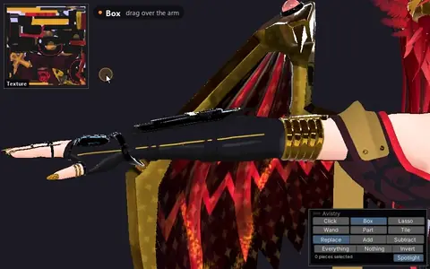
       <b>Box.</b> Drag around pieces, on the texture or straight on the model.
    </td>
    <td width="33%" valign="top">
      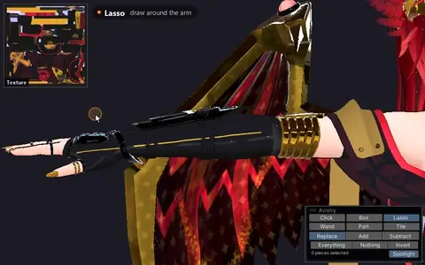
       <b>Lasso.</b> Draw any shape around the pieces you want.
    </td>
  </tr>
  <tr>
    <td width="33%" valign="top">
      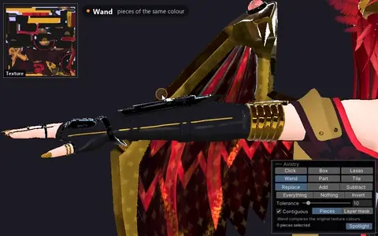
       <b>Magic wand.</b> Click a colour and every piece that has it is picked.
    </td>
    <td width="33%" valign="top">
      
       <b>By part.</b> One click takes every piece of a part.
    </td>
    <td width="33%" valign="top">
      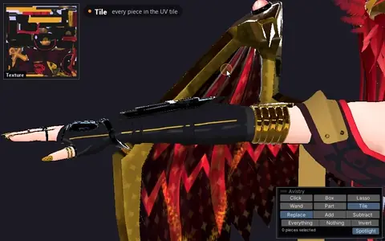
       <b>By UV tile.</b> Every piece in a tile, for avatars spread over several tiles.
    </td>
  </tr>
</table>

## What else it does

<table>
  <tr>
    <td width="50%" valign="top">
      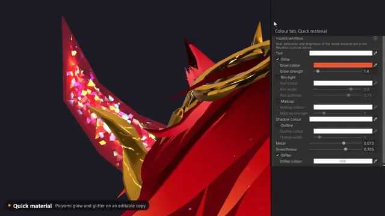
       <b>Recolour a whole material.</b> On Poiyomi and lilToon the shadow, rim, matcap, outline and emission
      colours follow along, through the shader's own settings.
    </td>
    <td width="50%" valign="top">
      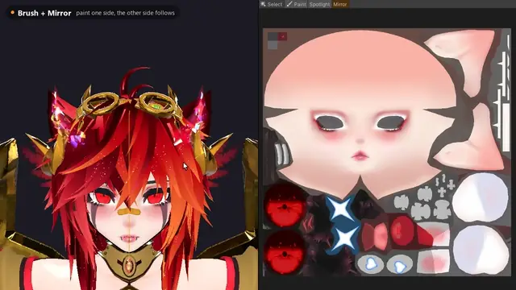
       <b>Paint.</b> 11 brushes with pen pressure, fill, gradients, blur and smudge. Paint on the texture or straight
      onto the 3D model, mirrored if you like.
    </td>
  </tr>
  <tr>
    <td width="50%" valign="top">
      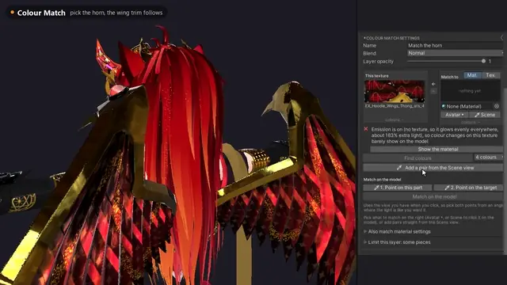
       <b>Match colours.</b> Give the hair the colours of the outfit, or the other way round, and keep the original
      shading.
    </td>
    <td width="50%" valign="top">
      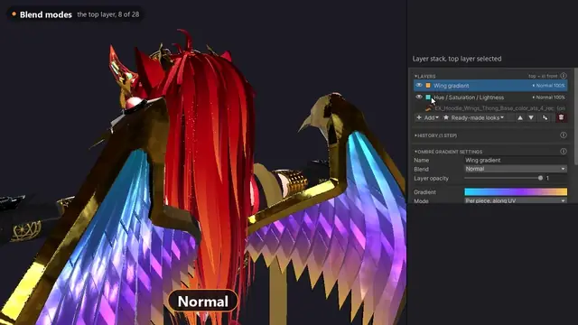
       <b>Work in layers.</b> 28 blend modes, masks, clipping, image layers and adjustment layers. Hide, reorder or
      undo any step.
    </td>
  </tr>
</table>

Also in the box:

- **Bake helper maps.** Ambient occlusion, a normal map from the texture and a face shadow map for anime-style faces.
- **Check your materials.** Pink shaders, empty slots, missing textures and wrong import settings, explained in plain
  words, with a one-click fix where it is safe.
- **Learn as you go.** Simple and Advanced modes, info icons, a 65-word glossary and a skill tree for Unity beginners.
- **Your language.** The whole tool is in English, Japanese, Korean and Simplified Chinese, and follows the Unity
  Editor's language by default.

Every feature is listed on the [Features page](https://avistry.github.io/avistry/features.html).

<!-- site-pages:start -->
## The website, page by page

Every page has its own picture. Click one to open it.

<table>
  <tr>
    <td width="50%" valign="top">
      <a href="https://avistry.github.io/avistry/features.html">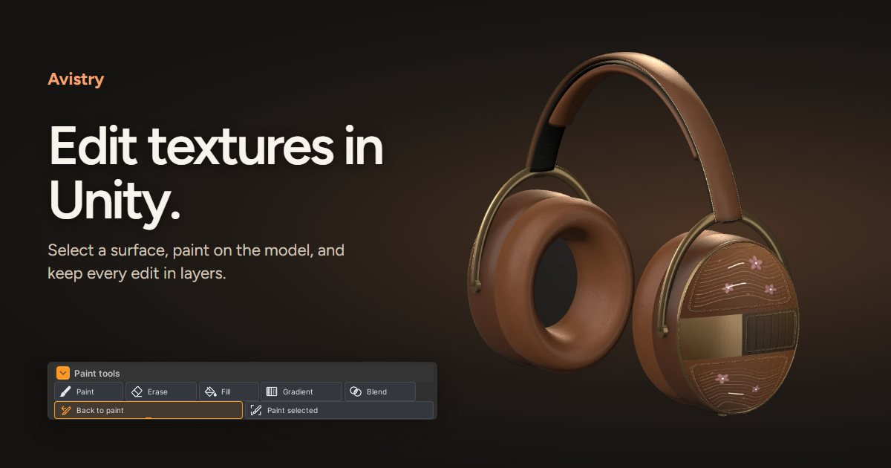</a>
       <a href="https://avistry.github.io/avistry/features.html"><b>Features</b></a> · Select pieces, paint on layers, recolour, tune the material and bake maps.
    </td>
    <td width="50%" valign="top">
      <a href="https://avistry.github.io/avistry/gallery.html">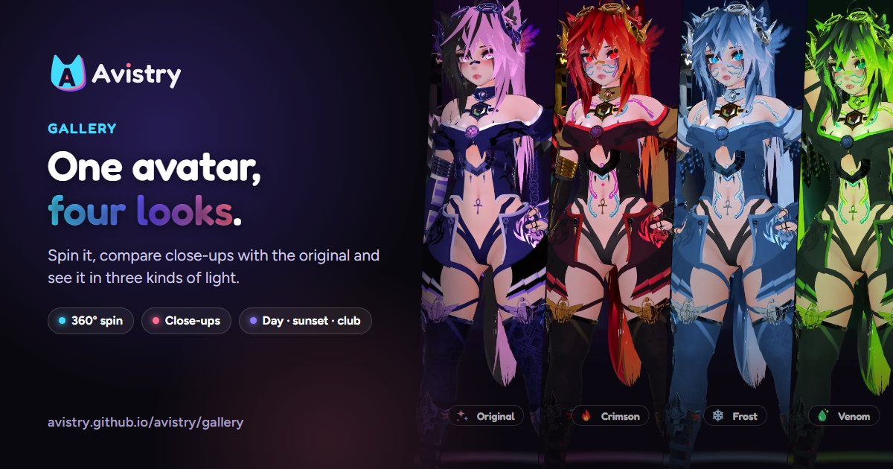</a>
       <a href="https://avistry.github.io/avistry/gallery.html"><b>Gallery</b></a> · Spin it, compare close-ups with the original and see it in three kinds of light.
    </td>
  </tr>
  <tr>
    <td width="50%" valign="top">
      <a href="https://avistry.github.io/avistry/learn.html">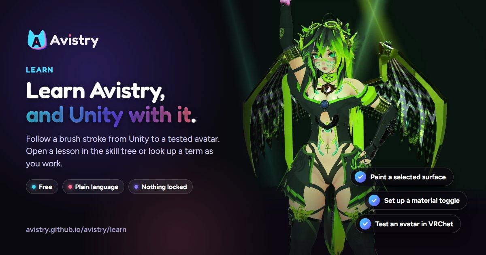</a>
       <a href="https://avistry.github.io/avistry/learn.html"><b>Learn</b></a> · Follow a brush stroke from Unity to a tested avatar. Open a lesson in the skill tree or look up a term as you work.
    </td>
    <td width="50%" valign="top">
      <a href="https://avistry.github.io/avistry/skills.html">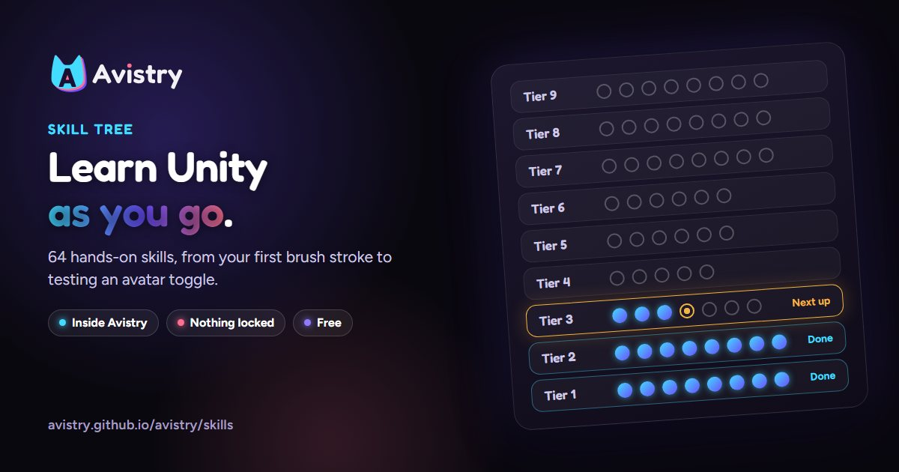</a>
       <a href="https://avistry.github.io/avistry/skills.html"><b>Skill tree</b></a> · 64 hands-on skills, from your first brush stroke to testing an avatar toggle.
    </td>
  </tr>
  <tr>
    <td width="50%" valign="top">
      <a href="https://avistry.github.io/avistry/glossary.html">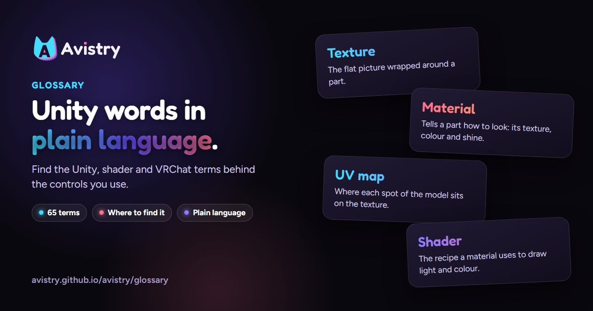</a>
       <a href="https://avistry.github.io/avistry/glossary.html"><b>Glossary</b></a> · Find the Unity, shader and VRChat terms behind the controls you use.
    </td>
    <td width="50%" valign="top">
      <a href="https://avistry.github.io/avistry/about.html">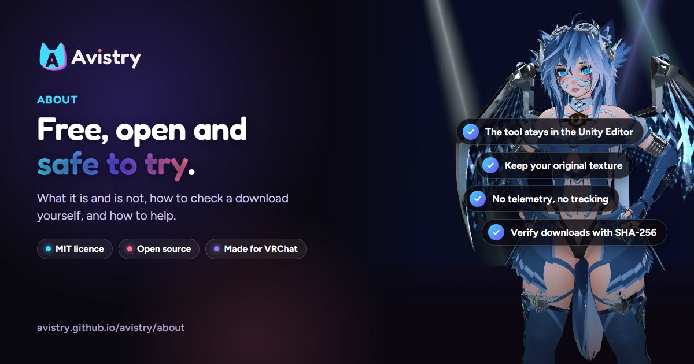</a>
       <a href="https://avistry.github.io/avistry/about.html"><b>About</b></a> · What it is and is not, how to check a download yourself, and how to help.
    </td>
  </tr>
  <tr>
    <td width="50%" valign="top">
      <a href="https://avistry.github.io/avistry/download.html">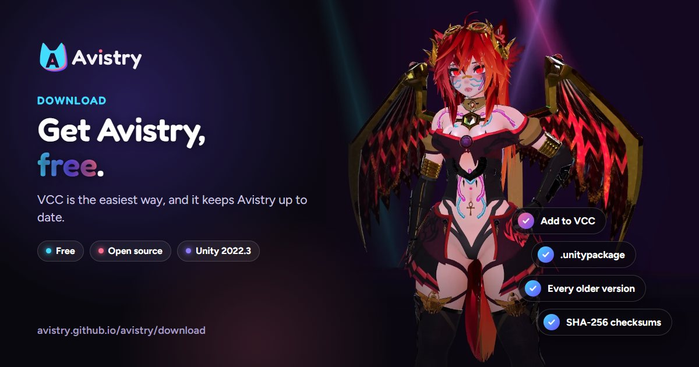</a>
       <a href="https://avistry.github.io/avistry/download.html"><b>Download</b></a> · VCC is the easiest way, and it keeps Avistry up to date.
    </td>
    <td width="50%" valign="top">
      <a href="https://avistry.github.io/avistry/">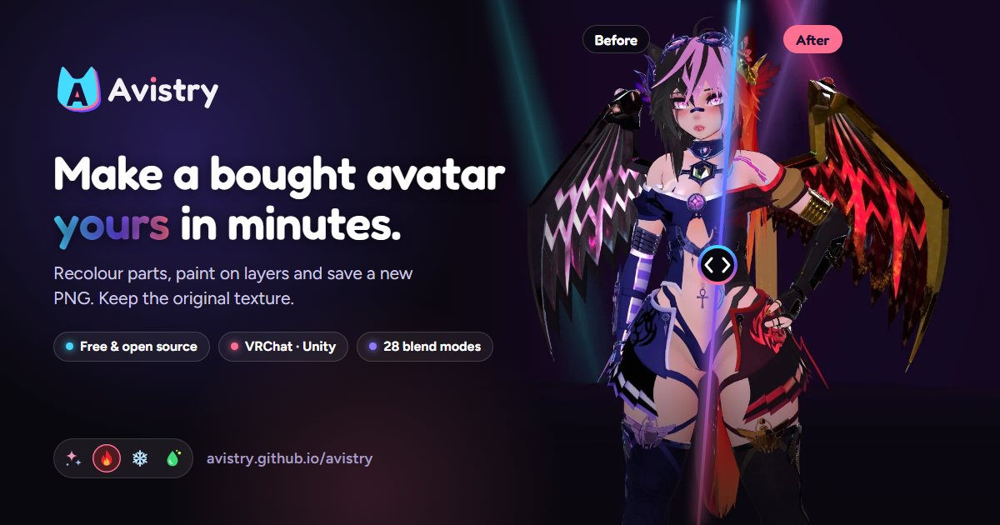</a>
       <a href="https://avistry.github.io/avistry/"><b>Home</b></a> · Recolour parts, paint on layers and save a new PNG. Keep the original texture.
    </td>
  </tr>
</table>
<!-- site-pages:end -->

## Why Avistry

You bought an avatar. Avistry is how it becomes yours. It is a VRChat avatar toolkit made with care: every tool has to
solve a real creator's problem, in plain words, and feel finished before it ships.

- **Safe by design.** It never overwrites your originals, lives only in the Unity Editor and sends no data. These are
  rules in the code, not settings.
- **Craft over volume.** One tool that works beats ten that almost do. We say no to features that add clutter.
- **Grown with the community.** Ideas are discussed on Discord, contributions are often built with AI agents, and the
  maintainers review and test every change in Unity. AI is a tool here, never the author.

  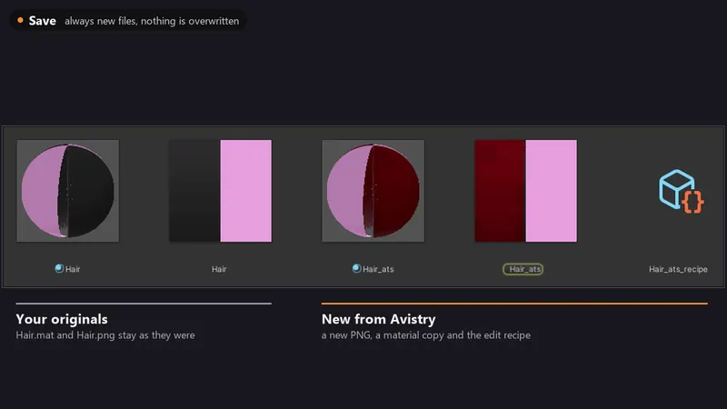
   Saving always makes new files. The original texture and material stay as they were.

<!-- release-banner:start -->

  
   What's new in 0.3.0 · Surface Studio · <a href="https://github.com/avistry/avistry/releases/tag/v0.3.0">Read the release notes</a>

<!-- release-banner:end -->

## Install

You need Unity 2022.3, the version VRChat uses. Pick one way and stick with it for updates.

**VRChat Creator Companion (recommended).** Open [our page](https://avistry.github.io/avistry/) and press
**Add to VCC**, or paste `https://avistry.github.io/avistry/index.json` into VCC under
*Settings › Packages › Add Repository*. Then press **+** next to Avistry in *Manage Project*. Updates show up there.

**.unitypackage.** Download it from the [latest release](https://github.com/avistry/avistry/releases/latest) and drag
it into the Project window. The tool goes into `Packages/com.avistry.toolkit`, not under Assets.

**Git URL.** In *Window › Package Manager*, press **+**, choose *Add package from git URL…* and paste
`https://github.com/avistry/avistry.git`.

No other packages are needed. If Poiyomi or lilToon is installed, the Colour tab gets extra options for it.
If you used the early AvatarTextureStudio test build, close Unity and move `Assets/AvatarTextureStudio` outside
the project before installing Avistry. Keep the folder as a backup in case it contains saved edits. The old build
looks for `Hidden/ATS/Layer`. If you see that shader name in an error after installing Avistry, check for old test
build files under Assets and open the current tool from **Tools › Avistry › Textures**.

## Quick start

1. Choose **Tools › Avistry › Textures**, select a part of your avatar and pick the texture.
2. Use **Colour** for a quick recolour, or **Select** a piece and **Paint** it. The avatar updates as you go.
3. In **Save**, press **Save as new PNG**.

Nothing is written until you save. Ctrl+Z undoes every edit, and closing with unsaved work asks you first.

## Safety and trust

- All the code is here, under the [MIT license](LICENSE). It is editor-only: nothing goes into your upload or runs in
  VRChat.
- Each download has a SHA-256 checksum in `SHA256SUMS.txt`. Compare it with
  `Get-FileHash <file> -Algorithm SHA256` in PowerShell. The release notes link to VirusTotal results when available.
- No telemetry. The only network call is an optional update check (Help › Check for updates automatically). It is off
  until you turn it on, asks GitHub's public API once a day for the latest version and sends nothing about you.
- Back up your project before trying any new tool, this one included.

<b>Use it with an AI helper (optional)</b>

Avistry can work with an AI app on your computer, such as Claude Code, Cursor or VS Code, through **MCP for Unity**,
a free package made by another team. Everything in Avistry works without it.

1. In *Window › Package Manager*, add `https://github.com/CoplayDev/unity-mcp.git?path=/MCPForUnity` from git URL.
2. Open *Window › MCP for Unity* and connect your AI app. It runs a server on this computer.
3. In Avistry, open **Help › Connect an AI helper…** and choose **Look only** or **Look and edit**. It starts **Off**.

Each AI action is one Ctrl+Z step named "AI: …". Saving and sending a picture of your texture wait for you to click
**Allow**. Our tools never overwrite your files, delete files or run code.

Good to know: MCP for Unity has its own tools, one of which can run any code in Unity, so keep your AI app's approval
prompts on. Names of parts, materials and textures go to the AI service you use. MCP for Unity collects usage data by
default; its documentation explains how to turn this off.

## FAQ

Will it change my original texture?

No. Saving creates a new PNG (<code>_ats.png</code>), a new material and a saved edit next to your originals.

Do I need Poiyomi or lilToon?

No. Painting, layers, selecting and saving work on any material. The shader-aware recolour and the face shadow map
need Poiyomi or lilToon.

Does it get uploaded with my avatar?

No. Only the PNG and material you save become part of your project.

My antivirus or VirusTotal flagged something.

Compare the SHA-256 of your download with the release's <code>SHA256SUMS.txt</code> and only download from this
repository's releases. Editor scripts sometimes get a false alarm from one or two engines. If it still looks wrong,
open an issue with the scan link.

It says test build. Is it stable?

Versions starting with <code>0.</code> are test builds. They work, but things still change. Back up first and tell us
what you run into.

How do I remove it?

In VCC, press <b>−</b> next to the package. Otherwise delete <code>Packages/com.avistry.toolkit</code>. Your saved
files stay.

## How this was made

Avatar creators tried the tool and told us what worked; we changed it based on that. We use AI on purpose, to build
faster and to check for security issues and bugs, and an experienced C# developer reads and checks the code. Our own
test harness drives the real Unity editor with automated feature tests, compile checks and screenshots. None of that
is a guarantee, so if you find a problem, please [open an issue](https://github.com/avistry/avistry/issues).

## Contribute

Pull requests are welcome. New features are discussed with the maintainers on [Discord](https://discord.gg/sSeWgDJJjY) first; you are welcome
to join. The [contributing guide](.github/CONTRIBUTING.md) explains how to report a bug, ask for a feature or send a fix.

| Folder | What is in it |
|---|---|
| [`Editor/`](Editor) | The tool: C# and shaders. This is all that ships. |
| [`Website~/`](Website~) | The website. |
| [`.github/`](.github) | [Contributing guide](.github/CONTRIBUTING.md), [security policy](.github/SECURITY.md), translated readmes, release workflows. |

## Credits and license

Made by Avistry contributors under the [MIT license](LICENSE). Every version is in the [changelog](CHANGELOG.md).
Some blend-mode formulas are adapted from TextureCraft (MIT), see [Third Party Notices](Third%20Party%20Notices.md).
Poiyomi Toon Shader, lilToon and the VRChat SDK are not included and belong to their authors. This project is not
affiliated with VRChat Inc.
